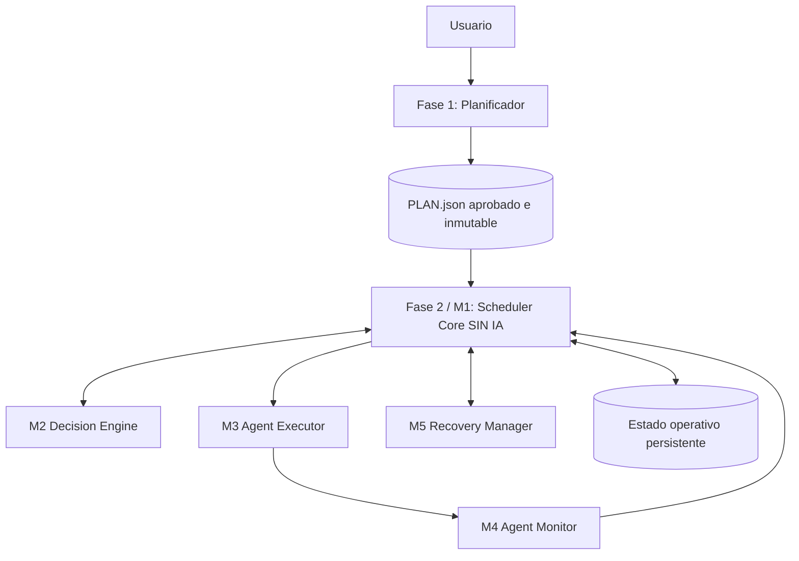

# Plan de implementación — M1: Scheduler Core

> **Identidad:** M1 es un **módulo hijo del sistema padre Scheduler**. No es un producto independiente, no reemplaza la metodología existente y no constituye un nuevo agente de IA.
>
> **Objetivo:** evolucionar la coordinación que hoy documenta `bitacora.py run` para que pueda consumir un `PLAN.json` aprobado, administrar tareas y dependencias con garantías transaccionales, permitir concurrencia segura y preservar estado ante fallos.
>
> **Regla inviolable:** **el Scheduler Core no usa IA**. No tiene prompts, modelos, agentes cognitivos, inferencia, tokens, selección de proveedores ni razonamiento semántico sobre código.
>
> **Estado del documento:** plan propuesto, **no ejecutado**. No afirma que rutas, comandos, esquemas o módulos aquí sugeridos ya existan en el repositorio.

## 1. Origen, pertenencia y límites de la arquitectura

### 1.1 Origen del sistema padre

La arquitectura acordada distingue **dos sistemas principales**:

1. **Fase 1 — Planificador (sistema independiente, temporal):** estudia el objetivo y repositorio, genera `SPEC.md`, `PLAN.md`, `PLAN.json` y, cuando corresponda, `HANDOFF.md`; valida el plan aprobado y **termina**. Su evolución está documentada en `PLAN-MEJORA-PLANIFICADOR.md` (`PLAN-PLANNER-001`).
2. **Fase 2 — Scheduler (sistema padre, persistente durante la ejecución):** recibe el plan estructurado y coordina su ejecución mediante módulos especializados. Se ejecuta como un **programa convencional**, no como un agente orquestador omnipresente.

### 1.2 Árbol del Scheduler

```text
SISTEMA: Scheduler (Fase 2)
│
├── M1. Scheduler Core       ← ESTE PLAN; lógica determinista y control de estados
├── M2. Decision Engine      ← Asignación y estrategia; IA bajo demanda
├── M3. Agent Executor       ← Lanzamiento y control de Claude/Codex/Gemini
├── M4. Agent Monitor        ← Eventos y señales de actividad; sin IA
└── M5. Recovery Manager     ← Diagnóstico de recuperación y propuestas de reintento

Infraestructura transversal: contratos, persistencia, permisos y trazabilidad.
No se convierten en otros servicios por defecto.
```

Los nombres M1–M5 son **IDs de módulos del Scheduler**, no hitos de implementación dentro de este documento. Para evitar ambigüedad, los hitos internos se identificarán como **SC-H1, SC-H2, ...**, y sus tareas como **SC-T01, SC-T02, ...**.

### 1.3 Ubicación en el flujo completo



**El Planificador no forma parte del Scheduler.** Los módulos M2–M5 son **hermanos de M1** bajo el mismo padre, no subcomponentes que M1 deba implementar; M1 únicamente conoce sus **interfaces**.

### 1.4 Principio de responsabilidad única

**M1 responde:** «¿Qué tareas del plan están habilitadas, qué estado tiene cada una, qué recursos pueden reservarse y qué acción autorizada corresponde ejecutar a continuación?»

**M1 no responde:** «¿Qué modelo es mejor?», «¿Cómo corregir este bug?», «¿Qué significa este log de Sonnet?», «¿Debe escalarse a Opus?», «¿Cómo se compila este repositorio?». Estas son responsabilidades de otros módulos o de la validación existente.

## 2. Evidencia y compatibilidad con la metodología actual

El archivo exportado de metodología compartido contiene, entre otros:

- `REQ-014/SPEC.md`: describe un supervisor de maratón `bitacora.py run`, ejecución por tareas/sesiones, niveles de escalamiento y límites.
- `REQ-016/PLAN.md` y `HANDOFF.md`: hitos (`M1`, `M2`), tareas (`T1`, `T2`, `T3`), dependencias `after`, comandos de verificación, ejecución en sesiones nuevas y auditorías independientes.
- `REQ-016/RUN.json`: registra `status`, `tasks`, `attempts`, `heartbeat`, `session_pids`, `last_route`, `error_hashes`, `evidence`, `limits` y `pool`. En el ejemplo examinado `workers` es 1 y algunos campos de clasificación están vacíos.
- `REQ-013/PLAN.md`: presenta fases con dependencias y posibilidad de paralelizar unas respecto de otras.

**Inferencia y cautela:** esos registros prueban que existen *conceptos y trazas* de supervisión, pero **no equivalen a una auditoría del código fuente** de `bitacora.py`. El primer hito de este plan consiste en localizar la implementación real y distinguir funciones existentes de mejoras necesarias. No crear duplicados de capacidades ya implementadas.

**Compatibilidad obligatoria:** conservar `SPEC.md`, `PLAN.md`, `HANDOFF.md`, `RUN.json`, la bitácora, los estados y las auditorías existentes; no modificar la historia de ejecuciones antiguas ni cambiar arbitrariamente el significado de sus campos.

## 3. Objetivo funcional y no objetivos

### 3.1 Resultado esperado

Al finalizar M1 debe existir un **núcleo ejecutable y testeable sin IA** que, usando adaptadores simulados, pueda:

1. Cargar un `PLAN.json` aprobado de una revisión específica y rechazar planes inválidos.
2. Construir y recorrer su DAG de tareas y dependencias.
3. Desbloquear tareas cuando sus prerrequisitos estén **completados y verificados**.
4. Controlar el ciclo de vida de tarea, intento y ejecución sin transiciones inválidas.
5. Reservar cupos y recursos de forma atómica antes del despacho.
6. Permitir tareas independientes en paralelo si las restricciones lo permiten.
7. Entregar órdenes a un **puerto de ejecución**, sin conocer la implementación del CLI.
8. Recibir resultados/eventos mediante contratos, deduplicarlos y actualizar el estado persistente.
9. Garantizar que un fallo no bloquee otras ramas independientes del DAG.
10. Reiniciar, reconstruir el estado y reconciliar intentos incompletos sin asumir éxito o fracaso.
11. Exponer interfaces estables a M2–M5, manteniendo ejecución básica con dobles de prueba.

### 3.2 Fuera del alcance de M1

- Elegir Haiku, Sonnet, Opus, GPT, Gemini, cuentas, perfiles o presupuestos; lo hará **M2**.
- Lanzar procesos reales, configurar autenticación de proveedores, implementar adaptadores CLI o crear worktrees; lo hará **M3**.
- Interpretar `stream-json`, calcular tokens, monitorizar stdout/stderr o clasificar el significado de errores; lo hará **M4**.
- Elegir política de reintento, cambiar de modelo, reanudar contextos de IA o diagnosticar bloqueos; lo hará **M5**, que propone medidas sujetas a M1.
- Implementar agentes de revisión o escribir suites de validación de producto: se **reutilizarán** los mecanismos de la metodología; M1 consumirá su veredicto estructurado.
- Replanificar hitos o reescribir `PLAN.json`; le corresponde a una **nueva ejecución del Planificador**.
- Construir dashboard, infraestructura distribuida, colas Kafka/Redis o microservicios por defecto.
- Desplegar a producción, modificar datos de clientes o ejecutar comandos destructivos.

## 4. Contratos y fuente de verdad

### 4.1 Entrada de planificación

**Entrada:** `PLAN.json` validado conforme al contrato de la Fase 1, identificado por `plan_id`, `revision` y `schema_version`.

Campos de tarea que M1 utiliza directamente:

| Campo | Uso determinista en M1 |
|---|---|
| `id`, `milestone_id` | Identidad, agrupación y trazabilidad |
| `after` | Dependencias del DAG |
| `repository` | Ámbito de ejecución y conflicto |
| `shared_resources` | Candidatos a reservas exclusivas o compartidas según políticas |
| `expected_paths` | Pistas de conflicto **no exhaustivas**; no garantizan independencia |
| `acceptance_criteria`, `verification` | Referencias que se entregarán a verificación, sin evaluarlas con IA |
| `complexity`, `scope`, `estimated_minutes`, `risk`, `coupling`, `confidence` | **Metadatos opacos para M1**; se pasan a M2, nunca se usan para elegir modelos |

`estimated_minutes` **no es un timeout**. M1 no debe interrumpir tareas porque supere su duración estimada; los límites operativos vendrán de configuraciones explícitas, no de inferencias del plan.

### 4.2 Separación de plan y ejecución

- `PLAN.json`: fuente de verdad de **qué debe hacerse**, inmutable para la revisión aprobada.
- Almacén operativo: fuente de verdad de **qué está ocurriendo**, incluyendo tareas, intentos, reservas y eventos.
- `RUN.json`: mantiene la interfaz visible/compatible que utiliza la metodología actual. Su rol exacto (almacén operativo original o proyección) se resolverá tras inspeccionar `bitacora.py`.
- `PLAN.md`: documento humano; sus checkboxes **no sustituyen** el estado operativo.

**Una sola autoridad de escritura en cada ejecución.** Está prohibido mantener SQLite y `RUN.json` como dos fuentes de verdad editables sin un protocolo de consistencia. Propuesta técnica a evaluar: estado transaccional en **SQLite WAL** para nuevas ejecuciones, con `RUN.json` como **proyección/exportación compatible**; si la inspección demuestra que el mecanismo existente es suficiente, justificar conservarlo. Las ejecuciones antiguas no se migran ni alteran automáticamente.

### 4.3 Interfaces entre módulos (puertos)

Los nombres siguientes son **contratos conceptuales**, no rutas ni clases ya existentes:

| Puerto | Emisor → receptor | Qué intercambia |
|---|---|---|
| `AssignmentPort` | M1 ↔ M2 | Tareas elegibles, capacidad conocida y propuesta de asignación; M1 valida |
| `ExecutionPort` | M1 → M3 | Orden de iniciar/cancelar/consultar intento con clave idempotente |
| `EventPort` | M4 → M1 | Eventos normalizados con identidad y correlación |
| `RecoveryPort` | M1 ↔ M5 | Contexto de fallo y propuesta de acción, sin mutar estado directamente |
| `VerificationPort` | Validador existente → M1 | Veredicto verificable por `attempt_id`, evidencia y resultado |
| `StateRepository` | M1 ↔ almacenamiento | Transacciones, consultas, eventos y reservas |

**Regla:** ni M2 ni M4 ni M5 pueden marcar tareas como completadas ni escribir el estado autoritativo directamente. Solicitan acciones o emiten hechos; M1 decide si corresponde una transición válida.

### 4.4 Propuesta mínima de contrato de evento

```json
{
  "event_id": "evt-0001",
  "plan_id": "REQ-EXAMPLE",
  "revision": 1,
  "task_id": "T1",
  "attempt_id": "att-0001",
  "source": "executor-adapter",
  "kind": "execution_started",
  "occurred_at": "2026-10-14T18:00:00Z",
  "payload": {}
}
```

El ejemplo define la **forma mínima**. La implementación añadirá versión de contrato, causalidad, orden local y token de reserva/fencing donde proceda. No se asumirán eventos «exactly once»: pueden llegar repetidos, tarde o desordenados. M1 deberá ser **idempotente y rechazar transiciones obsoletas**.

## 5. Funcionamiento esperado del núcleo

### 5.1 Algoritmo de elegibilidad

Una tarea `T` es elegible si, como mínimo:

1. Pertenece a la revisión aprobada y cargada.
2. No ha sido completada, cancelada ni bloqueada sin resolución.
3. Todos los elementos en `T.after` están en estado `completed` **con verificación aceptada**.
4. No tiene un intento activo ni reserva incompatible.
5. Existen recursos suficientes bajo los límites explícitos del sistema padre.
6. Una política de recuperación no ha impuesto espera, pausa o intervención.

La posición de una tarea en `PLAN.json` o en un hito no crea dependencias implícitas. Dos tareas de hitos distintos pueden estar listas simultáneamente si su DAG y las políticas lo permiten.

### 5.2 Separación de tarea, intento y asignación

- **Task:** unidad lógica estable que pertenece al plan.
- **Attempt:** ejecución concreta de una tarea, con identidad única; puede fallar sin que la tarea esté agotada definitivamente.
- **Assignment:** propuesta/selección del ejecutor efectuada por M2 (o simulador); M1 controla si puede reservarse.
- **Reservation/lease:** reclamación transaccional y temporal de cupo/recursos vinculada a un intento; libera o se reconcilia según su estado.

Nunca debe existir **más de un intento escritor autorizado por tarea al mismo tiempo**. Un `lease` vencido **no prueba** que el proceso anterior esté muerto: antes de transferir propiedad hay que reconciliar mediante `ExecutionPort` y, si corresponde, aplicar fencing para invalidar escrituras obsoletas.

### 5.3 Máquina de estados propuesta

```text
pending -> ready -> reserved -> running -> verifying -> completed
             ^        |          |            |
             |        v          v            v
             +-- retry_ready <- failed_attempt <- verification_failed
                     |
                     +--> blocked  (si Recovery agota alternativas)

cancelled: salida controlada desde estados no terminales cuando la política lo autoriza.
```

**Concreción obligatoria durante SC-H2:** una tabla formal de transiciones, precondiciones y eventos; distinguir estados de *tarea* de estados de *intento*, para no mezclar `failed_attempt` con una tarea permanentemente bloqueada. El diagrama es orientativo, no el esquema final de almacenamiento.

**Invariantes:**

- `completed` solo con veredicto de verificación aceptado y correlacionado al intento vigente.
- `running` solo después de reserva válida y confirmación correspondiente del ejecutor.
- Eventos tardíos de un intento anterior no pueden cerrar o alterar el intento vigente.
- El Core no convierte un mensaje «terminé» del agente en aceptación por sí solo.
- `blocked` no cancela ni bloquea automáticamente tareas independientes.
- No puede haber salto de `pending` a `completed` sin evidencia y transiciones válidas.
- `cancelled` y `completed` son terminales salvo reapertura explícita registrada mediante nueva revisión/operación autorizada.

### 5.4 Concurrencia y recursos

M1 gestiona capacidad global y reservas, no la elección de modelos:

- `max_parallel_tasks` global y capacidad provista por los adaptadores; valores configurables.
- Reserva atómica con clave de tarea, intento y recurso.
- Un bloqueo de conflicto se representa como identificadores de recurso normalizados (`repo`, `schema`, `service`, etc.).
- `shared_resources` aporta señales; una tarea con superficie desconocida no recibe automáticamente permiso de paralelismo.
- `expected_paths` son orientativos: dos rutas distintas no aseguran ausencia de conflictos de contratos/BD.
- El Executor prepara worktrees/aislamiento real; M1 administra la reserva lógica y verifica que no duplique escrituras.
- La paralelización debe ser **conservadora por defecto** cuando el estado de conflictos sea incierto; su política deberá probarse.

### 5.5 Ciclo por eventos, sin espera ocupada

```python
# Pseudocódigo ilustrativo; NO es implementación lista para ejecutar.
async def scheduler_core_loop():
    await recover_and_reconcile()
    while not execution_is_terminal():
        apply_persisted_events_transactionally()
        ready_tasks = resolve_ready_tasks()
        capacity = current_capacity()
        if ready_tasks and capacity:
            proposals = request_assignments_through_port(ready_tasks, capacity)
            for proposal in proposals:
                if validate_and_reserve_atomically(proposal):
                    record_dispatch_intent(proposal)
        dispatch_recorded_intents_through_port()
        await wait_for_event_or_reconciliation_deadline()
```

`request_assignments_through_port` **no contiene un LLM**: en M1 se inyectará un simulador determinista; M2 lo implementará en otra fase. El loop debe poder permanecer inactivo sin consumir CPU en polling agresivo ni tokens.

### 5.6 Despacho seguro ante caídas

Reservar y luego iniciar un proceso son operaciones distintas; una caída entre ambas puede duplicar ejecuciones. Se exige una estrategia documentada (por ejemplo, **outbox transaccional** + claves idempotentes + reconciliación):

- Persistir intención de despacho y reserva **antes** de pedir lanzamiento.
- Reintentar la entrega sin crear dos intentos lógicos.
- Si M3 recibe la misma orden dos veces, debe existir un contrato para reconocerla; en M1 se verifica con un adaptador falso.
- Si un proceso se inició pero no llegó su confirmación, consultar el estado real antes de despacharlo otra vez.
- En caso de incertidumbre irreconciliable, dejar tarea en estado seguro pendiente de intervención, no correr dos escritores.

### 5.7 Recuperación de proceso Scheduler

Al arrancar:

1. Abrir el almacén con las protecciones de consistencia definidas.
2. Comprobar que la revisión de `PLAN.json` coincide con la asociada a la ejecución.
3. Reproducir/cargar el estado válido, verificar reservas y deduplicar eventos pendientes.
4. Identificar intentos en estados intermedios (`reserved`, `running`, `verifying`).
5. Consultar por `ExecutionPort`/`EventPort` a los módulos de ejecución sobre dichos intentos. **No inferir muerte a partir de un PID o heartbeat por sí solo**.
6. Reconciliar de manera conservadora; si faltan datos, dejar explícita la incertidumbre.
7. Continuar el resto de tareas habilitadas.

M1 **no decide** reintentar con otro proveedor: entrega el caso a `RecoveryPort` o aplica una política determinista mínima explícitamente autorizada y probada; la estrategia pertenece a M5.

### 5.8 Fin de la ejecución

El Core diferencia:

- `completed`: todas las tareas requeridas tienen verificación aceptada.
- `completed_with_blockers` / `blocked`: no quedan tareas ejecutables ni intentos activos, pero sí hay tareas bloqueadas o dependientes imposibilitadas.
- `cancelled`: cancelación autorizada y registrada.
- `paused`: parada operativa intencional o espera de intervención/recursos; **no** equivale a completado.

Los nombres finales se alinearán con los estados ya existentes; el punto crítico es **no declarar éxito por el simple hecho de que ya no haya tareas `ready`**.

## 6. Hitos internos de implementación

> Cada hito tiene dependencias explícitas. Los comandos concretos de prueba se fijarán **después de inspeccionar el código real**; no se inventan rutas existentes.

### SC-H1 — Auditoría del supervisor actual y diseño de interfaces

**Objetivo:** aprovechar `bitacora.py` y documentar la línea base sin duplicar capacidades.

- [ ] **SC-T01 — Localizar el supervisor y sus productores/consumidores.** Encontrar `bitacora.py run`, su CLI, persistencia (`RUN.json`, heartbeats), parseo de `PLAN.md`, estados y políticas. Identificar módulos ya implementados y cobertura existente. **Entrega:** mapa real de llamadas y dependencias. **Aceptación:** cada responsabilidad existente está localizada por ruta y prueba o marcada como no localizada.
- [ ] **SC-T02 — Congelar compatibilidad y fixtures históricas.** Preparar ejemplos de `REQ-013`, `REQ-014`, `REQ-015`, `REQ-016` solo lectura; describir cómo preservar ejecuciones previas y cómo convivirá `PLAN.json`. **Después de:** SC-T01. **Aceptación:** baseline y pruebas que detectan cualquier cambio no autorizado de historial.
- [ ] **SC-T03 — Aprobar contrato de puertos y decisión de persistencia.** Definir interfaces versionadas `AssignmentPort`, `ExecutionPort`, `EventPort`, `RecoveryPort`, `VerificationPort`, `StateRepository`. Decidir de manera explícita y documentada el almacén transaccional. **Después de:** SC-T01, SC-T02. **Aceptación:** contratos probables mediante simuladores; una única autoridad operativa designada.

### SC-H2 — Lectura del plan, DAG y máquina de estados

**Objetivo:** transformar el plan aprobado en tareas elegibles y estados consistentes.

- [ ] **SC-T04 — Plan Loader versionado.** Consumir `PLAN.json`, validar versión y revisión aprobada, rechazar esquemas incompatibles sin modificar estado. **Después de:** SC-T03. **Aceptación:** planes válidos cargan; inválidos, modificados o con revisión inesperada no inician trabajos.
- [ ] **SC-T05 — Resolver DAG y elegibilidad.** Respetar `after` entre hitos, sin dependencias implícitas por orden; detectar bloqueos provocados por prerrequisitos no completados. **Después de:** SC-T04. **Aceptación:** pruebas de topología, desbloqueo y ramas independientes.
- [ ] **SC-T06 — Máquina de estados formal.** Separar estado de tarea/intent/reserva, implementar transiciones y guardas, incluyendo `verifying` y `completed` únicamente con veredicto aceptado. **Después de:** SC-T04. **Aceptación:** transiciones inválidas rechazadas y pruebas de propiedades/invariantes.

### SC-H3 — Persistencia, concurrencia y despacho determinista

**Objetivo:** ejecutar decisiones autorizadas sin carreras ni duplicaciones.

- [ ] **SC-T07 — Almacén transaccional y event log.** Persistir plan/revisión, tareas, intentos, eventos, reservas y transiciones; proveer operaciones idempotentes y consulta del estado. **Después de:** SC-T06. **Aceptación:** integridad bajo caídas simuladas y concurrencia de escritores.
- [ ] **SC-T08 — Reservas atómicas de recursos.** Implementar cupos, locks lógicos, leases/fencing y exclusividad por tarea. **Después de:** SC-T05, SC-T07. **Aceptación:** dos despachos simultáneos no pueden reclamar la misma tarea/recurso incompatible.
- [ ] **SC-T09 — DispatchPort y outbox.** Publicar intenciones de despacho y su confirmación con idempotencia, usando un Executor falso que soporte errores, duplicados y latencia. **Después de:** SC-T08. **Aceptación:** reinicio entre reserva y despacho no produce dos ejecuciones autorizadas.

### SC-H4 — Ciclo de eventos y recuperación del Core

**Objetivo:** seguir avanzando ante eventos, fallos y reinicios sin hacer trabajo de M4/M5.

- [ ] **SC-T10 — Bucle de control y recepción de eventos.** Integrar DAG, estado y despacho; adaptar eventos normalizados, deduplicar y soportar espera no ocupada. **Después de:** SC-T09. **Aceptación:** varias tareas independientes evolucionan según los eventos del simulador.
- [ ] **SC-T11 — Inicio y reconciliación.** Reconstruir tareas/intentos/reservas, consultar estado de ejecutores simulados, detectar procesos inciertos y no reejecutarlos a ciegas. **Después de:** SC-T10. **Aceptación:** pruebas de reinicio en cada transición crítica.
- [ ] **SC-T12 — Fronteras para recuperación y decisiones.** Invocar mocks de M2 y M5; aceptar/rechazar propuestas por reglas; no diagnosticar semánticamente fallos ni seleccionar modelos. **Después de:** SC-T10, SC-T11. **Aceptación:** una recomendación inválida no compromete el estado y un fallo local no detiene ramas independientes.

### SC-H5 — Integración retrospectiva, verificación y entrega

**Objetivo:** demostrar que M1 funciona aislado y no rompe la metodología.

- [ ] **SC-T13 — Pruebas end-to-end con puertos simulados.** Recorrer planes con dependencias, tareas paralelas, auditoría externa falsa, errores, bloqueo y cancelación. **Después de:** SC-T12. **Aceptación:** todos los criterios AC de §7 tienen evidencia reproducible.
- [ ] **SC-T14 — Compatibilidad y migración opt-in.** Mantener comandos, lectura y estados históricos; si hay nueva persistencia, exportar/proyectar `RUN.json` sin doble autoridad. **Después de:** SC-T11, SC-T13. **Aceptación:** fixtures históricos intactos y operaciones viejas soportadas o incompatibilidades documentadas y aprobadas.
- [ ] **SC-T15 — Documentación, handoff y reporte.** Documentar contratos para M2–M5, transiciones, mecanismos de recuperación, instrucciones de prueba y límites. Actualizar la metodología pertinente y generar reporte con evidencia real, riesgos y pendientes. **Después de:** SC-T13, SC-T14. **Aceptación:** nueva sesión puede desarrollar M2 sin depender del contexto conversacional.

**Orden recomendado:** SC-H1 → SC-H2 → SC-H3 → SC-H4 → SC-H5; en cada hito se permiten ramas independientes según los `after` de sus tareas, pero **este plan no asigna modelos ni agentes**.

## 7. Criterios de aceptación (obligatorios)

| ID | Dado / Cuando / Entonces |
|---|---|
| **SC-AC01 — Sin IA** | **Dado** M1 sin credenciales de proveedores ni conexión externa, **cuando** corre toda su suite y una simulación completa, **entonces** funciona sin inicializar SDKs de LLM, prompts o consumo de tokens. |
| **SC-AC02 — Padre e interfaces** | **Dado** el árbol modular, **cuando** se inspecciona la implementación, **entonces** M1 pertenece al Scheduler y solo conoce los contratos versionados de M2–M5. |
| **SC-AC03 — Plan aprobado** | **Dado** un `PLAN.json` válido y aprobado, **cuando** se carga, **entonces** se vincula por `plan_id` y `revision` y no se modifica su contenido. |
| **SC-AC04 — Plan inválido** | **Dado** JSON malformado, revisión cambiada o DAG inválido, **cuando** se carga, **entonces** no se crea ni despacha ningún intento. |
| **SC-AC05 — Dependencias** | **Dadas** tareas `T1 -> T2`, **cuando** T1 no está completada y verificada, **entonces** T2 no es elegible; al aceptarse T1, pasa a ser elegible si no hay otras restricciones. |
| **SC-AC06 — Paralelismo** | **Dadas** tareas independientes y recursos suficientes, **cuando** el simulador ofrece múltiples asignaciones válidas, **entonces** M1 permite ejecución simultánea hasta la capacidad configurada. |
| **SC-AC07 — Sin doble ejecución** | **Dadas** dos solicitudes concurrentes sobre la misma tarea, **cuando** ambas intentan reservarla, **entonces** como máximo una obtiene autorización de escritura. |
| **SC-AC08 — Recursos compartidos** | **Dadas** tareas que reclaman el mismo recurso exclusivo, **cuando** se planifican simultáneamente, **entonces** no obtienen reservas incompatibles; no se asume que worktrees eliminan conflictos externos. |
| **SC-AC09 — Estados válidos** | **Dado** cualquier estado de tarea/intento, **cuando** llega un evento, **entonces** solo se aplica si la transición es permitida y el intento coincide. |
| **SC-AC10 — Verificación obligatoria** | **Dado** un agente que informa éxito sin verificación, **cuando** M1 procesa el evento, **entonces** no marca la tarea `completed` hasta recibir una evidencia de aceptación independiente. |
| **SC-AC11 — Eventos duplicados** | **Dado** el mismo evento dos veces, **cuando** se recibe, **entonces** el estado y los contadores equivalen a procesarlo una sola vez. |
| **SC-AC12 — Eventos tardíos** | **Dado** un evento de intento obsoleto, **cuando** llega después de iniciar otro intento, **entonces** no modifica la tarea o reserva vigente. |
| **SC-AC13 — Despacho idempotente** | **Dada** una caída entre registrar el despacho y confirmarlo, **cuando** M1 reinicia, **entonces** reconcilia y evita lanzar dos ejecutores activos para el mismo intento. |
| **SC-AC14 — Fallo localizado** | **Dada** una tarea fallida, **cuando** sus dependientes quedan sin habilitar, **entonces** las ramas independientes siguen ejecutándose. |
| **SC-AC15 — Reinicio seguro** | **Dado** el Scheduler reiniciado en cualquier estado intermedio, **cuando** reabre la ejecución, **entonces** conserva decisiones confirmadas y no declara muertos procesos solo por un heartbeat antiguo. |
| **SC-AC16 — Fallo de M2/M5** | **Dado** un puerto de decisión o recuperación indisponible o inválido, **cuando** M1 recibe ese resultado, **entonces** conserva la integridad del estado y continúa trabajo permitido por políticas existentes; no inventa selección de modelo. |
| **SC-AC17 — Resultado correcto** | **Dadas** tareas `blocked`, `paused` o canceladas, **cuando** no quedan tareas elegibles, **entonces** M1 no anuncia éxito global salvo cumplimiento explícito del contrato de finalización. |
| **SC-AC18 — Compatibilidad** | **Dados** `RUN.json` y documentos previos, **cuando** se despliega M1 para nuevas ejecuciones, **entonces** preserva su lectura/historial y no sobrescribe ejecuciones en curso. |
| **SC-AC19 — Observabilidad mínima** | **Dada** cada transición/reserva/despacho, **cuando** ocurre, **entonces** deja registro identificable y auditable con `plan_id`, `task_id`, `attempt_id`, tipo y momento; métricas profundas quedan para M4. |
| **SC-AC20 — Ejecución sin proveedores** | **Dados** un Plan y puertos falsos de M2–M5, **cuando** se ejecuta una prueba integral, **entonces** M1 coordina el flujo completo sin abrir Claude, Codex, Gemini ni conexiones de red. |

## 8. Matriz mínima de pruebas

| Grupo | Casos obligatorios |
|---|---|
| Loader de plan | Esquema/versiones, plan aprobado, revisión congelada, IDs y DAG inválidos |
| DAG | Cadena, abanico, diamante, dependencias entre hitos, desbloqueo parcial, rama fallida |
| Estados | Transiciones válidas/ilegales, evento de intento incorrecto, éxito sin verificación |
| Concurrencia | Reclamo simultáneo, locks exclusivos, cupos limitados, agotamiento/liberación de reservas |
| Persistencia | Transacción fallida, eventos repetidos, reconstrucción desde almacén, plan/revisión mismatch |
| Dispatch | Outbox pendiente, lanzamiento confirmado, entrega duplicada, caída entre reserva y orden |
| Reinicio | Caída antes/después de reservar, despachar, iniciar, verificar, completar y cancelar |
| Fallos | Sin Decision Engine, sin Recovery Manager, evento tardío, recurso desconocido, estado incierto |
| Integración | Plan ficticio con al menos 6 tareas; 3 independientes; verificación externa; falla local; reinicio |
| Metodología | Fixtures de REQ-013/014/015/016 en modo lectura; comandos vigentes sin regresión |

**Evidencia exigida:** tests automatizados con resultados y códigos de salida, logs de fallos simulados, prueba de no duplicidad con concurrencia real de pruebas y reporte de limitaciones. No se consideran verdes las pruebas omitidas por carecer de entorno; se registran como no ejecutadas.

## 9. Proceso de implementación y verificación

1. **Inspección:** leer código real de la metodología y sus convenciones, medir línea base, registrar decisiones y conflictos; no asumir rutas.
2. **Diseño:** definir contratos tipados/versionados y límites de responsabilidad, con revisión arquitectónica antes de persistencia/concurrencia.
3. **Prueba primero donde aporte valor:** construir simuladores/fakes que generen carreras, errores y reinicios reproducibles.
4. **Implementación incremental:** completar SC-H1..SC-H5, verificando cada hito con sus suites específicas.
5. **Antagonist / independent review:** reutilizar revisiones de la metodología para descubrir invariantes débiles y regresiones; no llamar auditoría al propio autor.
6. **Compatibilidad:** probar lectura/escritura en nueva ejecución con datos de prueba y **solo lectura** de registros históricos.
7. **Cierre:** reunir evidencia de SC-AC01..20, producir informe final, documentar decisiones, pendientes y límites conocidos.

**Política de cambios:** no editar `PLAN.json` aprobado ni planes históricos para hacer pasar pruebas; si la entrada está defectuosa, reportar y corregir a través del Planificador o una revisión aprobada. No deploy/push/migración remota sin autorización específica.

## 10. Entregables

1. Módulo **Scheduler Core** integrado a la arquitectura actual, sin IA.
2. Contratos públicos versionados para sus puertos hacia M2, M3, M4, M5 y validación.
3. Loader de `PLAN.json` aprobado y resolvedor de dependencias DAG.
4. Máquina de estados para tareas, intentos y reservas, con transiciones verificadas.
5. Persistencia con una autoridad operativa única y eventos auditables.
6. Control de concurrencia y reservas transaccionales de recursos.
7. Despacho idempotente a puerto simulado y reconciliación ante reinicios.
8. Pruebas de estrés/concurrencia/fallos y fixtures de integración sin proveedores.
9. Compatibilidad documentada con `bitacora.py`, `RUN.json` y metodología previa.
10. Documentación de contratos para construir los módulos hermanos en fases posteriores.
11. Informe final con verificación, cambios, decisiones, limitaciones y pendientes.

## 11. Definición de terminado (DoD)

- [ ] SC-T01..SC-T15 terminadas con evidencia.
- [ ] SC-AC01..SC-AC20 cubiertos por pruebas e inspecciones documentadas.
- [ ] Se puede arrancar M1 **sin credenciales de IA**, con un `PLAN.json` aprobado y un Executor falso.
- [ ] Se ejecuta al menos un DAG completo con concurrencia y aceptación externa simulada.
- [ ] Un fallo localizado no paraliza las ramas independientes.
- [ ] Se prueba reinicio en estados intermedios sin doble escritor ni cierre falso de tarea.
- [ ] No se puede alcanzar `completed` sin verificación independiente correlacionada.
- [ ] `PLAN.json` nunca se modifica desde M1; `RUN.json` histórico permanece intacto.
- [ ] El repositorio no introduce prompts, SDK de IA ni lógica de selección de modelos dentro de `scheduler-core`.
- [ ] Contratos para M2–M5 quedan documentados y probados con adaptadores falsos.
- [ ] Se ejecutan los gates existentes aplicables y se distinguen fallos preexistentes, bloqueos y pruebas no ejecutadas.
- [ ] Informe final y bitácora actualizados; no se publica nada sin autorización.

## 12. Decisiones pendientes a resolver **contra el código real**

1. ¿Dónde viven hoy el loop, el parser de tareas, el router y el almacenamiento de `bitacora.py`?
2. ¿Se mantiene `RUN.json` como fuente de verdad operativa o se adopta SQLite para nuevas ejecuciones? **Prohibida la doble autoridad**.
3. ¿Cuál es la semántica existente de `task done`, `task fail`, `heartbeat`, auditorías y límites? Conservarla o migrarla con compatibilidad explícita.
4. ¿Qué invariantes de recursos y aislamiento ya maneja el supervisor? Evitar segundo sistema de locks conflictivo.
5. ¿Cómo se verifica la aprobación del plan? Establecer el mecanismo real; **no considerar cualquier JSON válido como aprobado**.
6. ¿Cómo representar `blocked` por dependencia versus `blocked` por agotamiento y cómo reabrirlos con un evento autorizado?
7. ¿Qué formato y granularidad de evidencia produce actualmente la verificación para asegurar `completed`?
8. ¿Cómo preservar el CLI público y las rutas que otras herramientas ya consumen?

Estas preguntas **no habilitan detener el diseño por falta de detalle conversacional**: la primera tarea del implementador es inspeccionar el repositorio, documentar la respuesta y avanzar respetando las restricciones y políticas ya aprobadas.

## 13. Guía para implementar este plan con un agente

> Implementa **solo el módulo M1 — Scheduler Core** de la **Fase 2 / sistema padre Scheduler**, siguiendo `PLAN-SCHEDULER-CORE-M1.md` y la metodología existente. Primero inspecciona el código real de `bitacora.py` para reutilizar sus capacidades. Respeta `PLAN.json` como entrada congelada de planificación, separa estado operativo y usa interfaces simuladas para M2–M5. **No integres modelos de IA, no construyas Agent Executor/Monitor/Recovery/Decision Engine reales, no reescribas ejecuciones antiguas ni autorices despliegues.** Avanza por hitos internos SC-H1..SC-H5; entrega pruebas, evidencia de aceptación, compatibilidad y reporte final. Si descubres una incompatibilidad de arquitectura o un riesgo de datos no reversible, documenta y detén únicamente la operación insegura.

---

**Principio rector:** **M1 conoce el estado, no el contenido del razonamiento de los agentes**. El Scheduler Core administra tareas, dependencias y recursos de forma determinista; los módulos hermanos aportarán inteligencia, ejecución y recuperación sin poder corromper el núcleo.
