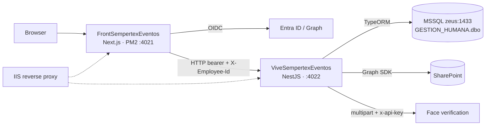

# eventos — Architecture

_Living document: how the thing is built (or, for business projects, how the process/organization works).
Edit in place; record the *why* of changes in DECISIONS.md._

## Overview
Sempertex event management system: create and manage events, teams and attendees; record attendance by a manager
(gestor) or by QR self check-in; capture signature/photo with facial verification; answer satisfaction surveys; generate
reports. Two separately built and deployed repos (not a monorepo): `FrontSempertexEventos` (Next.js 15 / React 19 web
app with NextAuth) and `ViveSempertexEventos` (NestJS 11 modular-monolith API). The browser gets a Microsoft Entra ID
session, sends the bearer token plus `X-Employee-Id` to the API, and the API resolves identity/role against MSSQL. The
API also talks to Microsoft Graph/SharePoint (images, reports) and to an external facial-verification service
(`identity.sempertex.com`, per the code). No queues or workers: every process is synchronous per request.
Analysis baseline (2026-09-23): FrontSempertexEventos@62f7701, ViveSempertexEventos@782c9f6.

## Components / actors
| Name | Responsibility | Where (path / owner) |
|---|---|---|
| FrontSempertexEventos | Frontend: Next.js 15 / React 19 web app (navigation, events, attendance, reports, local state) | `FrontSempertexEventos/src/app/layout.tsx`, `src/app/page.tsx` |
| NextAuth | Entra ID login, access-token refresh, Graph profile read | `FrontSempertexEventos/src/app/api/auth/[...nextauth]/auth.config.ts` |
| Web HTTP client (`useApiClient`) | Adds bearer + identity header, serializes requests, retries an expired token | `FrontSempertexEventos/src/app/hooks/useApiClient.ts` (uses `NEXT_PUBLIC_BACKEND_URL`) |
| Next route `/api/face-verification` | Server-side proxy to the face service (API key stays server-side); only checks a Bearer header is present | `FrontSempertexEventos/src/app/api/face-verification/route.ts` |
| ViveSempertexEventos | Backend: NestJS 11 API; bootstrap validates DTOs, accepts large bodies (50 MB), enables CORS, listens on 4022 | `ViveSempertexEventos/src/main.ts`, `src/app.module.ts` |
| AuthModule / AuthGuard | Verify RS256 JWT via JWKS (issuer, audience, expiry); map token to a person | `src/auth/auth.guard.ts`, `src/auth/jwks.service.ts`, `src/auth/auth.service.ts` |
| Authorization (AccesoGuard) | Translate identity to cédula/role; enforce global permissions | `src/autorizacion/acceso.guard.ts`, `src/autorizacion/autorizacion.service.ts` |
| Event team (EventoGestorService) | Resolve coordinator, collaborator, managers; per-event access and capabilities | `src/evento/evento-gestor.service.ts` |
| Events (EventoService) | Create, edit, close, register attendees, reports, evidence, delete events | `src/evento/evento.service.ts`, `src/evento/evento.controller.ts` |
| Attendance & check-in (AsistenteService) | Add/bulk-load attendees, check-in by manager/QR, signature, survey, pending verification | `src/asistente/asistente.service.ts`, `src/asistente/self-checkin.controller.ts` |
| Trainers (capacitadores) | CRUD, assignment to events, public verification by token (email) | `src/evento/capacitador.controller.ts`, `src/evento/capacitador-verificacion.controller.ts` |
| Azure/SharePoint storage | Create folders; upload/read/delete photos, evidence and PDFs via Graph | `src/azure/sharepointStorage.service.ts` (env `AZURE_*` / `SHAREPOINT_*`) |
| Local files (FileManager) | Process Excel/CSV; write temp files/reports to `uploads` | `src/FileSystem/FileManager.service.ts` |
| IIS (URL Rewrite/ARR) | Public edge on Windows server; reverse proxy to loopback 4021/4022 | `FrontSempertexEventos/web.config`, `ViveSempertexEventos/web.config` |

`EventoService` and `AsistenteService` are far above the 400-line threshold and mix rules, persistence and external
providers (see P-008).

### Business-rule owners
| Rule | Owner |
|---|---|
| Valid JWT and token-to-person mapping | `AuthGuard` + `AuthService` |
| Authorized global role | `AccesoGuard` + `AutorizacionService` |
| Permission within an event | `EventoGestorService` |
| Open/closed state and time window | `evento-lifecycle.utils` + `AsistenteService` |
| Only one attendance mark wins | Conditional SQL `UPDATE ... WHERE Asistencia = 0` in `AsistenteService` |
| Facial identity before `Firmado = true` | `verificarRostroExterno` (`src/asistente/face-verification.utils.ts`) + `AsistenteService` |
| Max three evidence photos per event | `EventoService` + SQL lock |

Employee identity can be resolved by header or by email; the API trusts both point to the same `EMPLEADO_SFSF`
record (centralized in `AuthService`, but the header originates in the web session).

## Data & integrations
- **MSSQL (source of truth):** Microsoft SQL Server (version not declared) on host `zeus:1433`, schema
  `GESTION_HUMANA.dbo`, database name by env; accessed via TypeORM + parameterized SQL, driver `mssql`,
  `trustServerCertificate:true` (production justification undocumented). Configured in `ViveSempertexEventos/src/app.module.ts`.
- **Discrepancy — PostgreSQL in Compose:** `ViveSempertexEventos/docker-compose.yml` starts PostgreSQL `latest` on host
  port 5434 (one container + named volume), but the API never connects to it. Compose is not a reproducible local
  topology (P-002). It also contains plaintext DB credentials (P-001).
- **Entities / tables** (all `synchronize:false`): `Evento` → `EVENTOS_EVENTO` · `TipoEvento` → `EVENTOS_TIPO` ·
  `Asistente` → `EVENTOS_ASISTENTE` (PK `(CedulaEmpleado, eventoId)`) · `EventoGestor` → `EVENTOS_EVENTO_GESTOR`
  (logical `Activo`) · `EventoCapacitador` → `EVENTOS_EVENTO_CAPACITADOR` · `Capacitador` → `EVENTOS_CAPACITADOR` ·
  `EventoUsuario` → `EVENTOS_USUARIOS` · `RolUsuario` → `EVENTOS_ROL_USUARIO` · `Empleado` → `EMPLEADO_SFSF`
  (read-only corporate view, writer unknown) · `VerificacionPendiente` → `EVENTOS_VERIFICACION_PENDIENTE` ·
  `EncuestaSatisfaccion` → `EVENTOS_ENCUESTA_SATISFACCION` · `EvidenciaEvento` → `EVENTOS_EVIDENCIA`.
- **New tables** (pending verification, survey, evidence) come from the loose script
  `ViveSempertexEventos/db/2026-09-verificacion-encuesta-evidencias.sql`: explicit FKs to the event, checks and unique
  indexes (one active pending per person, one survey per `(eventoId, CedulaEmpleado)`, rating 1–5, unique evidence
  name per event); no `ON DELETE`, no rollback. No TypeORM migrations or `migration:run` exist (P-003).
- `Asistente` ↔ `Empleado` is a logical N:1 (no FK/ORM relation; cédula compared as text/number). No `tenant_id` or
  multi-tenant filter observed (open question whether "empresa" is a tenant).
- **SharePoint via Microsoft Graph:** signatures, pending-verification photos, evidence and PDF reports; drive/folder
  per env; SDK with client credentials; folders per event. SQL keeps paths/links → eventual consistency between SQL and
  files; no shared rollback with Graph.
- **Microsoft Entra ID / Graph (frontend):** OIDC via NextAuth with API scopes + `User.Read`.
- **Face verification service:** external HTTP, multipart `cedula` + `file` with `x-api-key`; outcomes match / no
  match / down; synchronous, 20 s timeout, no queue or persistent retry.
- **In-memory caches:** per-process `Map` with TTL (identity/role 60 s, schedule 15 s); not a source of truth, no
  distributed invalidation.
- **Local files:** `uploads` directory relative to the build (Excel/CSV temp files, some reports).
- **Sensitive data:** `Empleado` exposes cédula, name, manager, company, gender, contract, birth date, position, email;
  `Asistente` adds signature, signature date, image, IP and device. Active signatures stored as bcrypt hash; images in
  SharePoint. The AES helper (`src/encryption/encryption.service.ts`) uses an empty password, an IV created at startup,
  and `decrypt` returns an empty string — not usable protection. No retention/encryption/backup policy in code (P-009).
- **Config:** everything via `process.env`/`ConfigService` (names in `auth.config.ts`, `face-verification/route.ts`,
  `app.module.ts`, `sharepointStorage.service.ts`, `src/auth/jwks.config.ts`); `.env*` git-ignored; no `.env.example`.

## Key flows
- **Login & API call:** NextAuth gets Entra tokens, uses refresh token to query Graph, stores the access token in the
  session; `useApiClient` sends it. `AuthGuard` fetches the key by `kid`, validates signature/issuer/audience/expiry,
  sets `request.user`; then `AccesoGuard` resolves cédula and role.
- **Create & manage event:** web calls `evento` controllers; `EventoGestorService` checks permission; `EventoService`
  validates dates/team/type, saves the event and registers attendees (some paths use `QueryRunner`; bulk load uses
  batch insert).
- **Check-in (with/without photo):** API checks membership and lifecycle, marks attendance with a conditional `UPDATE`
  (race-safe); with a photo it calls face recognition, hashes the signature, uploads the image to SharePoint and updates
  MSSQL. QR uses a signed event token + the attendee's Microsoft account: no manager role needed, but global auth is.
- **Pending verification:** if recognition is inconclusive, the photo goes to SharePoint, attendance is marked pending
  and a SQL row is created; an admin retries the verification. SQL is transactional, but SharePoint promotion/deletion
  happens afterwards, outside the transaction.
- **Reports & evidence:** backend queries MSSQL, generates Excel/PDF or receives a PDF, stores images/reports via
  Graph. The three-evidence limit is enforced in a SQL transaction, but the external upload does not share rollback.
- **Delete event:** `DeleteEvent` transacts attendees, managers, trainers and event, but skips the three new tables and
  SharePoint files (P-004).

## Conventions & constraints
- Commands (run from each repo root) — frontend: `npm ci`, `npm run dev`, `npm test`, `npm run test:cov`,
  `npm run lint`, `npm run typecheck`, `npm run build`, `npm run deploy`. Backend: `npm ci`, `npm run dev`, `npm test`,
  `npm run test:e2e`, `npm run test:cov`, `npm run lint`, `npm run build`, `npm run start:prod`.
- Ports: frontend PM2 4021, Nest API 4022; Next dev uses its default port unless changed.
- The API needs MSSQL access and env vars; `docker compose up` does **not** make the system ready (Compose = Postgres only).
- Schema uses `synchronize:false` and new SQL is not a migration; any schema change needs an external procedure.
- Photos/reports live in SharePoint; deleting SQL rows does not delete files.
- Face verification depends on URL, API key, network and certificates; 20 s timeout.
- Caches are process-local and not a source of truth; multi-instance would need externalized caches.
- Security edges to confirm (P-006): `enableCors()` with no explicit origins, `trust proxy`, issuer accepted by prefix
  (no tenant matrix), TLS termination/security headers not documented in `web.config`, 50 MB body/request limit, no
  rate limiting or WAF in repo.
- Dependencies use `^` ranges, Compose uses `postgres:latest`, no `engines` (P-007).
- Observability: TypeORM errors/warnings logged; a global interceptor logs requests > 1 s with duration and SQL query
  count (`src/common/latency-logging.interceptor.ts`). No metrics, traces, alerts or log retention in the repos; the
  only `GET /` returns `Hello World` behind the global guard (no readiness endpoint).
- Hefesto file-size threshold was 400 lines (`hefesto/config.toml`); the methodology's alert is 500.
- Inferred (not formally decided) architecture choices: separate front/back repos; NestJS modular monolith with one SQL
  connection; external MSSQL as source of truth with `synchronize:false`; SharePoint for binaries; event token scopes
  QR self check-in; Node behind IIS; frontend under PM2 in `fork` mode; secrets per environment.

### Open questions
- Official domain of each app, where TLS terminates, which CORS origins to allow.
- Is the Next route `/api/face-verification` still used, or should all verification go through Nest?
- Is MSSQL the official engine for all environments? Who controls the shared schema and migrations? Real schema/FKs of old tables?
- Retention, deletion and recovery requirements for signatures, photos, IP, devices, reports; RPO/RTO; SharePoint backup.
- Single instance or more? Does "empresa" mean multi-tenancy?
- Is there application monitoring outside the repos?

## Glossary
- **Evento** (event): managed activity with date, type, team, attendees and open/closed state.
- **Asistente** (attendee): person enrolled in an event and the record of their attendance, signature and check-in data.
- **Capacitador** (trainer): person who delivers or supports an event; internal or external.
- **Gestor** (manager): user assigned to an event with operational permission to administer it.
- **Coordinador** (coordinator): main person responsible for the event, or global user with role `COORDINADOR`.
- **EventoGestor**: persisted event–manager association, with `Activo` state.
- **EventoCapacitador**: persisted event–trainer association, including attendance and verification.
- **TipoEvento** (event type): catalog defining the event class and whether it requires signature or gift (obsequio).
- **Empleado** (employee): record from the corporate view `EMPLEADO_SFSF`; resolves cédula, name and job attributes.
- **Cédula**: national ID number used as the person identifier.
- **RolUsuario** (user role): global role catalog: `SUPERADMIN`, `ADMIN`, `COORDINADOR`, `COLABORADOR`.
- **EventoUsuario**: global authorization of a cédula to a role.
- **Check-in**: operation that marks attendance; started by a manager or by the attendee via QR.
- **Firma** (signature): evidence captured at attendance; on the active path a hash is stored and the image lives outside SQL.
- **Verificación pendiente** (pending verification): captured attendance whose facial identity awaits admin/external resolution.
- **Encuesta de satisfacción** (satisfaction survey): a person's rating and comment about an event.
- **Evidencia de evento** (event evidence): photo taken during an event, with author and SharePoint link.
- **SharePoint**: Microsoft external storage used for photos, evidence and reports.
- **Reporte** (report): attendance or general Excel/PDF report, stored temporarily or in SharePoint.
- **Apertura temporal** (temporary opening): exception allowing attendance to be recorded while an event is closed.

_Last updated: 2026-10-08_
