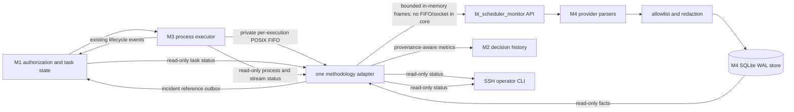
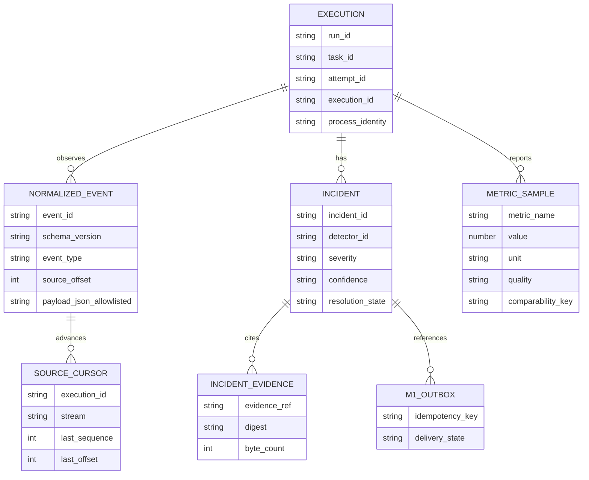

# REQ-017 — Accepted M4 architecture and ADRs

Status: approved by owner on 2026-10-15; implementation is tracked in `PLAN.md`.

## Boundaries and data flow



The existing M3 lifecycle path remains separate from the new stream tap. M3 runs the provider reader in a detached `shim` process, so a queue in the scheduler's memory cannot carry its frames. M3 owns a private POSIX FIFO per execution under its attempt directory. The shim writes small frames with `O_NONBLOCK`; the one methodology adapter reads the FIFO and passes in-memory frames into M4's public API. The FIFO is local file IPC, not a network service. The M4 package never opens FIFOs/sockets or spawns processes; it receives in-memory frames and writes its own SQLite store using a path supplied by the adapter. M3 records attempted/sent/dropped byte and offset summaries in its own durable execution status. The adapter drains the FIFO into a bounded queue and performs normalization/storage on another worker. M4 cannot launch, cancel, signal, restart or resume a process. It correlates only observations carrying a matching M1 attempt and M3 execution/process identity. A missing source event is represented as unknown or a stream gap, never inferred as a process exit.

`bt_scheduler_monitor` stays an isolated standard-library package and knows no sibling `bt_*` modules. One methodology adapter outside that package bridges its public API to the M1 audit port, M2 metric read port, M3 status/stream capabilities, and the SSH CLI. The existing `bt_scheduler_adapter.py` remains the scheduler composition root and may wire this new adapter once T11 completes.



## Proposed versioned contracts

Version rules: schema versions use `major.minor.patch`; additive optional fields may advance minor, incompatible semantic changes advance major, and parsers preserve unknown fields only as an unknown-field count/digest. They do not copy unrecognized payloads. Every record is tagged with the producer schema version and the normalizer version. A source schema unsupported by an adapter yields a visible `unsupported_source_schema` gap and does not fabricate a normalized event.

### M3 to M4 — `ExecutionOutputFrame` 1.0.0

An immutable frame passed to the isolated package by its one methodology adapter. M3 transports frames through a private POSIX FIFO per execution, owned under the M3 attempt directory with mode `0600`. The wire format is a fixed magic/version/length header plus raw bytes; the full execution correlation is carried by an M3 stream manifest read through its adapter. The bytes are never written to the M4 database. The adapter rejects unexpected owner/path/symlink state; the M4 package itself receives only in-memory values.

```text
schema_version: "1.0.0"
run_id, plan_revision, task_id, attempt_id, execution_id: opaque identifiers
process_identity: { platform, host_boot_id?, pid?, start_ticks? }
provider: claude | codex | antigravity | gemini_fixture | unknown
profile_id: opaque string | null
model: string | null
stream: stdout | stderr
sequence: nonnegative integer, monotone per execution and stream
offset_bytes: nonnegative integer, monotone per execution and stream
received_at: UTC RFC3339 timestamp
received_monotonic_ns: integer | null
host_boot_id: string | null
data: bytes, maximum 3,840 bytes per frame (approved Linux cap)
wire_frame_bytes: maximum PIPE_BUF bytes, 4,096 on the target Linux platform (verify at runtime)
```

M3 owns both provider pipe readers and continues draining regardless of reader/storage health. It splits each 65,536-byte OS read into FIFO frames no larger than `PIPE_BUF`, then writes each whole frame with `O_NONBLOCK`. Since a frame is no larger than `PIPE_BUF`, POSIX guarantees an atomic write; when no reader exists or the bounded kernel FIFO is full, the whole frame is dropped rather than blocking the pipe reader. M3 increments dropped byte/frame counters and records the missed sequence/offset range. When delivery resumes, it first sends a versioned `stream_gap` frame. The adapter drains the FIFO and enqueues frames into a separate bounded queue capped at 10,000 frames and 16 MiB total buffered bytes, whichever fills first; queue overflow is counted and represented as a gap when the cursor resumes. `M3StreamSummary` 1.0.0 is exposed through M3's read-only execution status with per-stream bytes read/sent/dropped, last sequence/offset and dropped ranges. It lets M4 detect loss even if the entire attempt ran while the adapter was down. A restart, changed boot identity, repeated offset or sequence discontinuity resets/cross-checks the cursor rather than silently joining unrelated process output.

This approved boundary keeps M3's 65,536-byte read granularity and 10,000 pending-event precedent while adding a 16 MiB byte budget. The shim uses one selector-driven reader to preserve one ordered combined M3 artifact as it reads both separately labeled channels. The monitor adapter polls M3's read-only status for new FIFO endpoints, resolves only a relative `stream_ref` inside the project state root, checks file type/owner/mode/execution identity, and closes the reader after the matching execution is terminal and drained. T12 measures FIFO/queue memory and throughput and may set derived CPU/RSS/throughput budgets; it does not relax the approved queue and evidence caps without an explicit plan revision.

### M3 to M4 — `M3StreamSummary` 1.0.0

The M3 read-only execution status gains an additive summary with `execution_id`, `process_identity`, a private relative `stream_ref` resolved only by the M3 adapter, provider/profile/model metadata, `stdout_bytes_read`, `stdout_bytes_sent`, `stdout_bytes_dropped`, `stderr_bytes_read`, `stderr_bytes_sent`, `stderr_bytes_dropped`, per-stream `last_sequence`/`last_offset`, bounded dropped ranges, and summary schema version. It contains no output bytes, prompt, command line, credentials or excerpts. M4 consumes it to discover the FIFO and recover explicit gap evidence after receiver downtime. Older M3 versions without this field report stream completeness as `unknown`.

### M4 normalized event — `NormalizedEvent` 1.0.0

Required envelope fields:

```json
{
  "schema_version": "1.0.0",
  "event_id": "sha256:<stable source identity and normalized kind>",
  "source_schema_version": "provider schema or unknown",
  "normalizer_version": "1.0.0",
  "run_id": "run-opaque",
  "plan_revision": 3,
  "task_id": "T4",
  "attempt_id": "attempt-opaque",
  "execution_id": "execution-opaque",
  "process_identity": {"platform": "linux", "host_boot_id": "boot-id", "pid": 1234, "start_ticks": 5678},
  "provider": "codex",
  "profile_id": "profile-opaque",
  "model": null,
  "event_type": "tool_started",
  "source_event_type": "item.started",
  "source_event_id": null,
  "source_occurred_at": null,
  "received_at": "2026-10-15T16:00:00Z",
  "received_monotonic_ns": 123456789,
  "host_boot_id": "boot-id",
  "stream": "stdout",
  "sequence": 12,
  "offset_bytes": 4096,
  "payload": {"tool_label": "exec", "argument_bytes": 884, "argument_digest": "sha256:..."},
  "evidence_ref": "event:sha256:...",
  "quality": "reported"
}
```

`payload` is a typed allowlist, not a provider object. Candidate normalized types are `process_started`, `tool_started`, `tool_finished`, `message_delta` (counts only), `usage_reported`, `checkpoint_written`, `process_exited`, `heartbeat`, `auth_error`, `quota_error`, `transport_error`, `timeout`, `launch_error`, `stderr_diagnostic`, `stream_gap` and `unsupported_source_schema`. Text bodies, reasoning, tool arguments, command lines, file paths, MCP arguments/results, environment variables and credential-like values are never retained. `message_delta` stores counts/byte sizes only. Tool argument digests are optional; if digesting would require retaining unrestricted input, store only a byte count.

Provider timestamps are optional source facts. M4 records its own UTC receipt timestamp and monotonic timestamp. The monotonic value is meaningful only with the same host boot identity. Missing model, profile, source event ID, PID start time or timestamp stays null/unknown; it is not inferred from unrelated events.

### Incident and evidence — `Incident` 1.0.0

The stable incident key is derived from `run_id`, `attempt_id`, `execution_id`, `detector_id`, and the detector's dedupe window/key. Repeated evidence increments `occurrence_count` and `last_seen_at` on the same incident. Resolution is an observed condition, not a task-state transition.

```json
{
  "schema_version": "1.0.0",
  "incident_id": "sha256:...",
  "run_id": "run-opaque",
  "task_id": "T4",
  "attempt_id": "attempt-opaque",
  "execution_id": "execution-opaque",
  "process_identity": {"platform": "linux", "host_boot_id": "boot-id", "pid": 1234, "start_ticks": 5678},
  "detector_id": "quota_explicit",
  "type": "quota_error",
  "severity": "high",
  "confidence": "high",
  "first_seen_at": "2026-10-15T16:00:00Z",
  "last_seen_at": "2026-10-15T16:00:00Z",
  "occurrence_count": 1,
  "facts": {"source_code": "provider_allowlisted_code", "process_exit": 1},
  "evidence_refs": ["event:sha256:..."],
  "resolution_state": "open",
  "resolved_at": null
}
```

`IncidentEvidence` stores only event IDs, digests, counts, offsets, allowlisted codes and bounded redacted excerpts. If redaction fails, the excerpt is absent. The full record stays M4-owned; only a small reference crosses into M1.

### M4 to M1 — additive audit-only reference 1.2.0

Approved M1 event kind: `incident_observed`, with `source="m4"`, `incident_id`, the minimum run/task/attempt/execution correlation identifiers, `detector_id`, `severity`, `confidence`, `observed_at`, and a stable idempotency key. The M1 event recorder may append the reference to its audit log and project it as an informational observation. The reducer must leave task and attempt state byte-for-byte equivalent to applying no incident event. Existing M1 consumers that do not understand v1.2.0 are not sent this event; M4 keeps the item pending in its outbox until an explicit capability check succeeds. Retries are at least once and idempotent by the key.

### M4 to M2 — read-only metric snapshot 1.0.0

```json
{
  "schema_version": "1.0.0",
  "metric_id": "sha256:...",
  "provider": "codex",
  "profile_id": "profile-opaque",
  "model": null,
  "name": "output_tokens",
  "value": 128,
  "unit": "tokens",
  "source": "provider_reported",
  "observed_at": "2026-10-15T16:00:00Z",
  "quality": "reported",
  "sample_count": 1,
  "comparability_key": "codex/profile-opaque/unknown-model/output_tokens"
}
```

Quality is one of `reported`, `partial`, `estimated`, `unavailable`, `unknown`. Unknown quota remains unknown, never infinity or zero. Token values are not comparable across providers by default; a caller must match provider, profile/model where known, metric name/unit, and comparability key. M2 consumes these facts read-only and may keep its existing deterministic policy when they are absent.

## Activity view

The per-attempt query projects separate fields: last source event, last received I/O, last observed tool label, pending observable tool events, provider-reported metrics, stream integrity, and M3 process status. Display states are `active`, `tool_pending`, `silent_but_live`, `source_disconnected`, `process_confirmed_dead` and `unknown`. A provider message or tool label is evidence that an event was reported, not a percent-complete or success signal.

M1/M3 snapshots are read-only. A process is considered confirmed dead only from M3's matching process identity and terminal observation; a PID alone is insufficient. Linux identity uses boot ID and `/proc/<pid>/stat` start ticks when available. Other platforms/permissions produce unknown identity rather than a fabricated match.

## Deterministic detector matrix

The owner approved the initial deterministic thresholds recorded in D-034. They remain configurable and must be validated against fixtures; elapsed thresholds use monotonic time only while boot identity matches. T12 measures runtime load but does not turn silence into process-death evidence.

| Detector | Evidence and initial trigger | Severity / confidence | False-positive control | Dedupe, suppression and resolution |
|---|---|---|---|---|
| `unexpected_exit` | Matching M3 terminal event with nonzero exit while M1 attempt was still active. | High / high | Require matching execution identity and active-state snapshot. | One per attempt/terminal identity; suppress after authorized cancellation; resolve only on corrected/reconciled M3 evidence. |
| `quota_explicit` | Allowlisted structured provider quota code/event. | High / high | Do not classify arbitrary text containing “limit”. | One per execution + provider code; repeated observations increment count; resolve on a new authorized execution or explicit M3 terminal completion. |
| `quota_probable` | Redacted stderr diagnostic indicates a quota limit and M3 reports failing exit. | Medium / medium | Heuristic requires both diagnostic class and failing exit; never parses arbitrary message body. | One per attempt/window; suppress duplicate stream offsets; resolve on later non-quota terminal evidence. |
| `auth_failure` | Structured auth error, or allowlisted 401/unauthorized code plus failing execution. | High / high structured; medium / medium heuristic | Text-only mention is insufficient. | One per execution/provider code; resolve on a new authorized execution. |
| `connection_error` | Structured transport error, or connection diagnostic plus failed exit/timeout. | Medium / medium | A transient disconnect without failed process is an observation gap. | One per execution/window; resolve on heartbeat/stream recovery or terminal event. |
| `timeout` | M3 timeout terminal fact or M1-provided execution deadline exceeded. | High / high for M3 fact; medium / medium for deadline comparison | M4 does not invent timeout policy; compare only a versioned supplied deadline and matching clock domain. | One per attempt/deadline; suppress after cancel; resolve on terminal M3 observation. |
| `missed_heartbeat` | No M3 heartbeat for 3 × configured heartbeat period (initially 90s from current 30s interval). | Medium / low | Source loss is not process death; show process status separately. | One per execution/continuous gap; resolve on next matching heartbeat. |
| `silent_but_alive` | Five minutes without provider output while M3 confirms the exact process identity is alive. | Info / low | Long provider operations are normal; configurable, informational only, never blocks/fails an attempt. | One per 5-minute quiet period; suppress repeats until new output; resolve on next frame or process terminal event. |
| `repetitive_activity` | Same allowlisted tool label and optional argument digest appears at least 20 times in 5 minutes with no distinct normalized event. | Info / low | Tool labels alone may repeat legitimately; no blocking action or progress judgment. | One per execution/window; suppress until the signature changes; resolve on a distinct event or window expiry. |
| `oversized_output` | Frame exceeds 65,536 bytes, normalized event exceeds the approved 16 KiB, or evidence exceeds the approved 4 KiB. | Info / medium | M3 splits normal output; only cap violations/truncation count. | One per execution/stream/window; emit `stream_gap`; resolve after a valid frame and cursor resynchronization. |
| `provider_stream_silence` | M3 process has observed I/O/heartbeat but parser has received no valid provider event for five minutes. | Info / low | Distinguish no-output operation from malformed/unsupported format; do not assert process failure. | One per execution/schema/window; resolve on valid event or source terminal state. |
| `pid_reuse` | PID matches but boot ID or start ticks differ from the active M3 execution identity. | High / high | PID is never identity on its own. | One per old/new identity pair; suppress old-process events; resolve when M3 reconciles the new identity. |
| `stale_post_cancel` | M1 records authorized cancel; matching execution sends a frame after M3 terminal cancellation plus the approved 2s drain grace. | Medium / medium | Allow in-flight output during grace; source/receive clocks remain separate. | One per execution/cancel revision; suppress during grace; resolve when late stream drains or M3 closes it. |
| `source_disagreement` | After a 30s reconciliation window, M1 says terminal while matching M3 identity is alive, or M3 says terminal while later stream frames arrive. | Medium / medium | Require current versioned snapshots and exact identity; otherwise classify unknown. | One per attempt/disagreement class; resolve on a newer consistent snapshot. |
| `stream_gap` | Sequence/offset skip, malformed/truncated object, decoder failure, queue overflow or store failure. | Info / medium (loss is known), low (cause uncertain) | Retain only missing range/count/digest; unknown payload stays untrusted. | Merge adjacent missing ranges; resolve when cursor resumes; keep the gap in audit history. |

For every rule, “resolution” updates the M4 incident record only. M4 never retries, cancels, resumes or transitions an M1 attempt.

## Persistence, retention and resource proposals

| Item | Approved limit or policy | Behavior at pressure |
|---|---|---|
| Store | One M4-owned SQLite WAL database per project under `.state/monitor/<project>/monitor.sqlite3`; never co-located by writing into M1/M3 databases. | Transactional cursor/incident/outbox writes. Busy/full errors are visible; no success is fabricated. |
| Tables | `normalized_events`, `source_cursors`, `activity_projection`, `incidents`, `incident_evidence_refs`, `metric_samples`, `daily_metric_aggregates`, `m1_outbox`, `store_health`. | Event insert and cursor advance share a transaction. Outbox delivery is retried at least once with stable keys. |
| Frame and normalized record | FIFO frame ≤`PIPE_BUF` (4,096 bytes on target Linux) with ≤3,840 data bytes; normalized event ≤16 KiB; redacted evidence excerpt ≤4 KiB. | Oversize becomes counts/offsets/digest and a gap; raw bytes never fall back into storage. |
| Queue | ≤10,000 frames and ≤16 MiB buffered bytes, whichever fills first. | Continue draining pipes; drop new stream payloads with explicit sequence/offset gaps, retain lifecycle handling separately. |
| Database | Owner-approved 512 MiB SQLite database-plus-WAL ceiling. | Expire eligible detail, compact aggregates, preserve open incidents and bounded undelivered outbox records, expose `storage_pressure`; if writes still fail, stop acknowledging unpersisted frames, expose a degraded/error state and record loss when storage recovers. Do not silently claim complete history. |
| Event detail | 90 days. | Delete expired normalized detail after aggregate/evidence references are made safe; cursor remains restart-safe. |
| Resolved incident detail | 365 days. | Keep compact count/summary after detail expiry if space permits. |
| Daily aggregates | 730 days. | Aggregate only like-for-like metric keys and units; never combine unknown comparability keys. |
| Open incidents | Retain until resolved; never evict them to fit the cap. | If open incidents and undelivered outbox records exhaust available storage after eligible detail is pruned and aggregates compacted, expose a degraded state and explicit gaps; do not fabricate resolution or successful delivery. |
| Runtime thresholds | CPU/RSS/throughput/p95 latency not set before measurement. | T12 records three simulated concurrent agents, event rate, queue behavior, DB growth and p95 delivery latency; set limits from that reproducible baseline. |

The owner approved these retention, cap and evidence limits in chat (D-033). T12 does not use real provider calls or quota; CPU/RSS/throughput/p95 budgets remain measurement-derived as approved in D-034.

## Proposed ADRs

### ADR-001 — Isolate M4 storage and use a standard-library monitor package

- **Context:** M1 and M3 each own state stores; legacy `bt_events` is append-only monthly history without a restart cursor/outbox. M4 needs deduplication, retention and retryable incident references.
- **Decision:** Create an isolated stdlib `bt_scheduler_monitor` package and a separate project-scoped SQLite WAL file owned only by M4.
- **Alternatives:** Write M4 tables into M1's database; overload M3's event store; extend legacy JSONL; add a service database.
- **Consequences:** Clear store ownership and local/headless deployment; duplicated database lifecycle and retention code; no cross-database transaction. Integrations use idempotent ports/outbox.
- **Rollback:** Stop M4 ingestion, retain its database for export/audit, disable M1/M2 adapters, and leave M1/M3 stores untouched.

### ADR-002 — Add a separate bounded M3 stream port

- **Context:** M3 captures provider output but currently merges stdout/stderr and emits only lifecycle facts to M1. Its lifecycle sink can delay the supervisor.
- **Decision:** Add a versioned private POSIX FIFO per M3 execution, with per-stream sequence/byte offsets, frames no larger than `PIPE_BUF`, nonblocking writes, M3-owned loss counters and explicit gaps; keep the lifecycle port unchanged and separate.
- **Alternatives:** Parse M3's output artifacts after completion; push each chunk through the direct M1 sink; have M4 read process pipes itself; add a socket endpoint.
- **Consequences:** Enables live monitoring and preserves M3 process ownership without a network API; requires coordinated M3 channel separation, FIFO path validation and queue/backpressure tests; dropped stream data becomes visible but is not replayed from M3 raw artifacts by M4.
- **Rollback:** Disable the stream-tap registration and return to lifecycle-only M1 events; do not alter existing M3 artifact ownership.

### ADR-003 — M4 incidents are advisory; M1 remains authoritative

- **Context:** Detectors can observe quota/auth/transport/process inconsistencies, but only M1 owns task state and only M3 can control a process.
- **Decision:** Store full incidents in M4 and send a minimal, versioned `incident_observed` reference to M1 as audit-only evidence; M2 receives metric snapshots read-only.
- **Alternatives:** Let M4 write M1 state directly; let incidents trigger retries; keep incidents only in M4 with no audit reference.
- **Consequences:** Preserves module authority and gives future M5 durable evidence; requires additive M1 capability negotiation and idempotent delivery. No detector can trigger a state transition.
- **Rollback:** Stop draining the M4 outbox to M1 and disable M2 metric reads; M4 evidence remains queryable and current M1 state is unchanged.

### ADR-004 — Minimize stored provider data and bound retention

- **Context:** Provider streams can include credentials, prompts, code, reasoning, tool arguments and private project data. Unbounded history is unsafe and operationally fragile.
- **Decision:** Persist typed allowlisted metadata, bounded redacted evidence or digest/count/offset only, with owner-approved 90/365/730-day retention, a 512 MiB database-plus-WAL cap and the explicit store-pressure path above.
- **Alternatives:** Store raw JSONL for later re-parsing; keep all records indefinitely; delete all history immediately after a run.
- **Consequences:** Reduces exposure and disk growth; limits forensic detail and makes schema evolution depend on versioned normalizers. Runtime CPU/RSS/throughput/p95 budgets require T12 measurement.
- **Rollback:** Disable collection of optional evidence fields and shorten retention; do not restore raw stream persistence.

These accepted ADRs are summarized in project decisions D-030–D-033. No repository ADR directory was created because the project has none.
