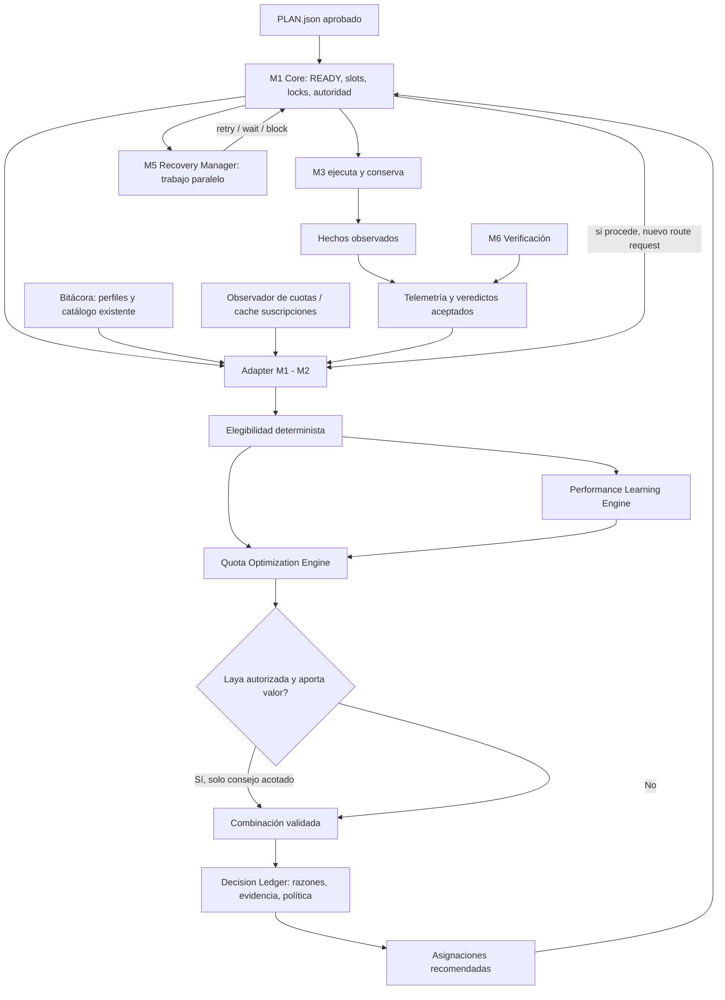

# Plan de implementación — M2: aprendizaje de métricas y optimización de cuotas

**Proyecto:** Bitácora / Planificador / Scheduler multiagente  
**Módulo objetivo:** M2 — Decision Engine  
**Fecha de elaboración:** 15 de octubre de 2026  
**Estado:** PLAN PROPUESTO PARA IMPLEMENTAR. No constituye una certificación del código actual.  
**Prioridad:** funcionalidad obligatoria para el entregable final M1–M6  
**Ejecución concurrente:** **M5 — Recovery Manager se está desarrollando en paralelo en un worktree independiente.**  
**Entorno objetivo:** Arch Linux local, headless/SSH, sin nuevos servicios pagos ni microservicios.  
**Alcance operativo:** un proyecto por ejecución; las cuentas de suscripción pueden ser compartidas con otras sesiones locales, pero el Scheduler no coordina todavía un portafolio multiproyecto.

---

## 0. Instrucciones críticas para el agente implementador

1. **Inspecciona el repositorio Git ACTUAL antes de tocar código.** Esta especificación se apoya en una exportación textual `dav033-metodologia-8a5edab282632443 (2).txt` y en el contexto maestro del 14/10/2026; cualquiera de sus datos puede haber cambiado.
2. **No reconstruyas M2 desde cero.** El repositorio exportado ya contiene `bt_scheduler_decision/`, `bt_scheduler_decision_adapter.py`, `bt_scheduler_laya.py`, `bt_scheduler_laya_worker.py`, `bt_scheduler_bench_*`, `bt_subscriptions.py`, `bt_quota_live.py`, `bt_events.py` y routing en `bt_agents.py`.
3. **M5 está siendo desarrollado simultáneamente por otro agente.** No edites `bt_scheduler_recovery*`, su rama/worktree, sus contratos privados ni el almacenamiento de M5. Congela los contratos de integración y coordina mediante un único responsable de integración.
4. **M1 es la única autoridad de ejecución y estados.** M2 propone rutas y planes de asignación; no reserva worktrees, no crea procesos, no marca tareas completas, no hace retries ni escribe directamente en la SQLite de M1.
5. **M5 propone recuperaciones; M2 propone rutas para una nueva asignación** cuando M1 lo solicite. M2 no invoca a M5 y M5 no selecciona modelos por cuenta propia.
6. No desactives los filtros duros de perfiles/proyectos, autenticación, políticas de proveedor, restricciones de cuota, validez del plan o capacidades de ejecución para mejorar una métrica de benchmark.
7. No inventes contadores de tokens, créditos, dinero o cuotas restantes. **Porcentajes de uso de suscripción, tokens reportados y capacidad realmente disponible son magnitudes distintas.** Toda estimación debe llevar tipo, fuente, rango de incertidumbre y fecha de caducidad.
8. No uses Laya como condición para que funcione el optimizador. Es opcional, bajo demanda y detrás de su compuerta de calidad. Si su evidencia no supera el baseline, debe permanecer inactivo.
9. No hagas deploy, push, merge destructivo, cambio de credenciales, renovación forzada de OAuth, llamadas de inferencia de pago ni modificaciones de producción sin autorización explícita.
10. La prueba final debe demostrar trabajo **aceptado y verificado**, eficiencia de cuotas y reducción de atención humana, no solo que el router produce un JSON o que hay más procesos activos.

---

## 1. Resultado buscado y definición de alcance

### 1.1. Objetivo

Convertir el M2 existente en un **Decision Engine con dos capacidades obligatorias**:

- **Performance Learning Engine:** aprende, a partir de evidencia verificada, qué combinaciones de proveedor/modelo/perfil/esfuerzo funcionan mejor por tipología y riesgo de tarea. Distingue éxito aceptado de afirmaciones del agente, errores de infraestructura, rechazos de verificación y reintentos.
- **Quota Optimization Engine:** optimiza la asignación de un lote de tareas elegibles sobre las cuentas autorizadas, teniendo en cuenta calidad esperada, cuota conocida, ventanas activas, reset, riesgo de agotamiento, volumen de tareas pendientes, trabajo concurrente y resultado histórico.

El sistema **no** pretende entrenar un modelo generativo ni convertir cuotas de suscripción a dólares ficticios. Debe seguir funcionando con política determinista cuando la muestra es escasa, Laya falla o la telemetría está incompleta.

### 1.2. Éxito operacional

Ante varios trabajos READY y un conjunto de suscripciones limitadas, el Scheduler debe decidir **qué tarea asignar a qué ruta elegible ahora**, qué capacidad preservar y cuándo no despachar. Debe registrar por qué, comprobar su efecto real y adaptar las decisiones posteriores mediante datos observados.

Se busca **maximizar trabajo verificado por unidad de capacidad de suscripción y por minuto de atención humana**, sujeto primero a reglas inquebrantables de seguridad, autorización, calidad mínima y capacidad. No reducir todo a una fórmula escalar opaca con unidades incompatibles.

### 1.3. No es responsabilidad de M2

- Supervisar procesos y heartbeats (M4 / señales reales de M3).
- Recuperar intentos, hacer backoff o esperar resets como estado de tarea (M5 aconseja, M1 autoriza).
- Certificar corrección funcional, integración o calidad (M6/verificador independiente).
- Ejecutar agentes, modificar worktrees o reusar handoffs directamente (M3).
- Poseer estado mutable de DAG, capacidad o ejecución (M1).
- Crear un panel empresarial o coordinador global de todos los proyectos.

---

## 2. Inventario observado: reutilizar antes que duplicar

> Estas observaciones son de la **exportación adjunta**, no constituyen inspección ni ejecución de pruebas del HEAD actual.

| Zona existente | Hecho observado | Acción prevista |
|---|---|---|
| `bt_scheduler_decision/contracts.py` + `api-contract.json` | `DecisionRequest`, `TaskFacts`, `Candidate`, `RouteHistory`, `DecisionRecord`, ids estables y estados de cuota | Mantener compatibilidad; añadir capacidades mediante evolución aditiva/versionada. |
| `bt_scheduler_decision/engine.py` + `policy.py` | Filtrado determinista, comparación de candidatos, elección opcional Laya y fallback | Extender ranking/política sin romper filtros ni calibración. |
| `bt_scheduler_decision/history.py` | Separación entre éxitos verificados, fallos verificados, claims, tiempos/tokens, y prior Beta(2,2) | Construir aprendizaje contextual sobre hechos reales; no interpretar prior como éxito calibrado. |
| `bt_scheduler_decision/recorder.py` | Registro SQLite de decisiones, huellas de entrada y referencias opacas a rutas | Evolucionar registro de política y auditoría; no crear segundo estado de ejecución. |
| `bt_scheduler_decision_adapter.py` | Traducción de planes/telemetría/rutas/cuotas, actualmente con una ruta de modelo/esfuerzo por perfil en `_candidate_rows` | Ampliar enumeración de combinaciones **reales soportadas**, no hardcodearlas. |
| `bt_subscriptions.py` y `bt_quota_live.py` | Muestras y cache de ventanas 5h/semanales; estado/errores/edad; fuentes por proveedor | Fuente compartida de observaciones de cuota. No son tokens restantes. |
| `bt_events.py`, `bt_agents.py`, perfiles | Telemetría e historial de resultados, modelo de cuentas, permisos y baseline de routing | Reutilizar identidad y métricas; extender únicamente donde haga falta. |
| `bt_scheduler_core/contracts.py` y `bt_scheduler_decision_adapter` | `AssignmentPort` de M1, lote READY, `free_slots`, propuestas validadas por M1 | Preservar M1; adaptar optimización de lote sin tomar autoridad. |
| `bt_scheduler_executor/` | Resultados técnicos y metadatos de intentos, handoff y clasificación de salidas | Consumir como señales, no como veredicto de calidad. |
| Laya local | Existe compuerta de benchmark; la exportación dice que el benchmark medido no autoriza su activación | Continuar por política determinista; reabrir Laya solo ante evidencia nueva válida. |

**Limitaciones reales de diseño detectadas en esa exportación:**

1. `DecisionRequest` formaliza una recomendación **por tarea**, mientras M1 entrega múltiples READY. El adaptador itera tareas hasta `free_slots`, pero no optimiza simultáneamente un lote ni evita que distintas propuestas acumulen presión sobre la misma cuenta.
2. `_candidate_rows` crea primordialmente un modelo/esfuerzo por perfil derivado de `bt_agents.model_for`. Una optimización de calidad/cuotas de verdad necesitará enumerar **todas las rutas configuradas y autorizadas**, sin permitir rutas inexistentes.
3. `RouteHistory` agrega métricas por identidad de ruta/tipo, con pocas dimensiones de contexto. El aprendizaje por complejidad, riesgo, acoplamiento, alcance e intentos requiere asociar con cuidado resultado final y clasificación de tarea.
4. La presión de cuota observada es una lectura del proveedor. No demuestra cuánto consumirá una tarea específica ni cuánto crédito queda convertible a tokens.
5. M2 actualmente excluye cuotas `unknown`/`stale`. Mantener ese comportamiento seguro como referencia; cualquier modo alternativo debe ser explícito, verificable y separado de la ruta automática estricta.
6. El porcentaje actual y la cercanía del reset no bastan por sí solos: podrían coexistir ventanas de 5h y semanales; optimizar solo el reset cercano puede agotar una ventana semanal.

---

## 3. Arquitectura objetivo y fronteras



**Separación estricta de datos:**

- **M1:** fuente de verdad de task/attempt/run, reservas, estados y autorizaciones.
- **M2:** datos derivados de selección, modelos estadísticos e historial de decisiones, sin propiedad de tareas.
- **M3/M4:** hechos técnicos, tiempos, eventos y consumo reportado.
- **M5:** política de reacción a incidentes, razones de reintento y solicitud de reevaluación (nunca modelo/cuenta elegidos).
- **M6/verificador:** calidad aceptada/rechazada y evidencia vinculada al intento; si M6 no está operativo, no suponer éxitos nuevos.
- **Bitácora:** fuente reutilizable de identidad de cuentas, perfil, uso y métricas, sin segundo recolector paralelo.

---

## 4. Contratos y trabajo paralelo con M5 — ACUERDO OBLIGATORIO

### 4.1. Distribución de propiedad de archivos y worktrees

| Área | Agente M2 (este plan) | Agente M5 (en paralelo) | Responsable de integración |
|---|---|---|---|
| `skill/scripts/bt_scheduler_decision/**` | Escribe | Solo lectura | M2 |
| `skill/scripts/bt_scheduler_decision_adapter.py` | Escribe | Solo lectura | M2 |
| `skill/scripts/bt_scheduler_recovery/**` | Solo lectura | Escribe | M5 |
| `skill/scripts/bt_scheduler_recovery_adapter.py` | Solo lectura | Escribe | M5 |
| `bt_scheduler_core/**`, contratos compartidos, `bt_scheduler_adapter.py` | **No editar concurrentemente** | **No editar concurrentemente** | Integrador único |
| `bt_subscriptions.py`, `bt_events.py`, `bt_agents.py`, `bt_profiles.py` | Cambio mínimo propuesto con coordinación | Solo lectura salvo contrato aprobado | Integrador único si ambos necesitan tocarlo |
| Pruebas de cada paquete | Propiedad respectiva | Propiedad respectiva | Cada agente; E2E compartido integra después |
| Artefactos de Bitácora de un mismo requerimiento | Sin escritura concurrente sobre el mismo archivo | Sin escritura concurrente | Integrador o áreas exclusivas |

- Crear dos worktrees reales de ramas separadas; usar exclusividad real, no solo convenciones en prompts.
- Congelar una revisión del contrato M1↔M2 y del contrato M1↔M5 antes de integración cruzada.
- El agente M2 puede definir propuestas aditivas de contratos en su propia documentación/tests pero **no aplicar una modificación a M1** en paralelo con M5.
- El integrador acepta cambios de contratos compartidos una única vez, con pruebas de regresión de ambos paquetes y preservando M3.

### 4.2. Contrato M5 ↔ M2 sin acoplamiento circular

No introducir un RPC directo `M5 -> M2`. El flujo oficial es:

```text
M3 informa fallo técnico
  -> M1 conoce incidente, consulta a M5
  -> M5 propone retry / wait / block + razones (contrato actual)
  -> M1 valida la propuesta, comprueba el fin efectivo del intento
  -> si corresponde un nuevo intento, M1 vuelve a pedir asignación a M2
  -> M2 considera cuota actual, exclusiones y evidencia del intento anterior
  -> M1 valida la nueva ruta y emite orden a M3
```

**Contrato mínimo existente de M5 en M1 (exportación):**

```python
FailureContext(plan_id, task_id, attempt_id, cause, attempts_used, max_attempts, detail="")
RecoveryProposal(action, reason="", wait_seconds=0.0)  # retry | wait | block
```

**Extensión deseable pero NO implementada/ni supuesta:** un contexto adicional, versionado y opcional para M2 en un *nuevo intento*:

```json
{
  "retry_context_version": "1",
  "previous_attempt_id": "ATT-42-1",
  "previous_route_id": "hash-ruta",
  "failure_cause": "quota_exhausted",
  "evidence_refs": ["m3:attempt:..."],
  "avoid_route_ids": ["hash-ruta"],
  "retry_policy": "prefer_alternate_when_safe"
}
```

- No incluir tokens, secretos, textos libres sin límites ni atributos arbitrarios inyectados al motor.
- `avoid_route_ids` es una restricción **solicitada por M1 bajo política aprobada**, no una orden arbitraria de M5. Si no existe una vía aprobada, M2 puede observar cuotas y estado actual y seguir con fallback seguro; la rotación sofisticada quedará bloqueada explícitamente hasta tener el contrato.
- Revisar `attempt_id`, `run_id`, revisión/hash del plan, identidad de cuenta y transiciones para impedir reutilizar evidencia de otro intento o proyecto.
- El optimizador debe respetar backoff/cooldown que ya impuso M1/M5; no intentar lanzamientos repetidos por su cuenta.

### 4.3. Protocolo de integración en paralelo

**Puerta P0 (antes de programar):** ambos agentes entregan inventario de módulos tocados y versiones de contratos; el integrador publica en la Bitácora la matriz de propiedad.  
**Puerta P1 (al completar núcleo aislado):** ambas suites de unidad pasan con puertos simulados sin importar el módulo hermano.  
**Puerta P2 (integración):** el integrador realiza cambios mínimos del core/adapter, conserva compatibilidad y valida idempotencia.  
**Puerta P3 (end-to-end):** fallos por cuota, rutas alternativas, sin capacidad y cuentas compartidas se prueban con M1/M3/M5 juntos.  
**Puerta P4 (aceptación):** métricas reales verificadas, sin atribuir uso a tareas sin evidencia.

---

## 5. Datos y observabilidad: modelo de cuotas

### 5.1. Identidades y unidad de capacidad

El recurso primario es la **cuenta efectiva de proveedor** (`account_ref`) y no el nombre del perfil. Dos perfiles que compartan la misma cuenta comparten cuota y NO pueden modelarse como capacidad independiente. Una cuenta puede tener varias ventanas/límites simultáneos y algunos límites específicos de modelo/clase; no asumir que una ventana de Sonnet es idéntica a una de Opus.

**Modelo lógico propuesto (v1):**

```json
{
  "schema_version": "quota-observation/1",
  "account_ref": "sha256-opaco",
  "provider": "claude",
  "model_scope": "provider-defined-or-unknown",
  "source": "subscription-cache",
  "observed_at": 0,
  "valid_until": 0,
  "status": "known",
  "windows": [
    {
      "window_id": "rolling_5h",
      "used_percent": 42.0,
      "reset_at": null,
      "reset_confidence": "unknown"
    },
    {
      "window_id": "weekly",
      "used_percent": 65.0,
      "reset_at": null,
      "reset_confidence": "unknown"
    }
  ],
  "pressure_source": "provider-reported"
}
```

Forma ilustrativa: los campos disponibles deben adaptarse a lo que realmente entregan los colectores, sin asumir resets publicados. Evitar persistir raw OAuth, correos, identificadores de cuenta, tokens o respuestas HTTP completas. Registrar la fuente de observación, su edad y el estado de autenticación por separado.

### 5.2. Semántica de estados

- `available_known`: todas las restricciones duras relevantes tienen observación fresca, autoridad válida y margen positivo, según semántica soportada.
- `exhausted`: ventana bloqueante confirmada, incluso si otra ventana se reinició.
- `stale`: observación caducada; no reinterpretar como cero uso.
- `unknown`: no hay información fiable; la ruta automática estricta actual la excluye. Un *modo de excepción supervisado* solo se implementará si se documenta un flujo explícito de autorización, con límite de gasto y auditoría.
- `invalid_auth` / `cooldown`: bloqueo independiente de disponibilidad aparente de cuota.
- `reset_reported`: fecha observada, no garantía futura. Tras reset requiere nueva observación o política explícita y conservadora.

**Regla de múltiples ventanas:** la ruta solo es elegible si todas las ventanas relevantes conocidas lo permiten y ninguna condición bloqueante está vigente. Un reset cercano de 5h jamás habilita una cuenta agotada semanalmente.

### 5.3. Lectura y refresco

- Leer muestras cacheadas de `bt_subscriptions` y mecanismos existentes de `bt_quota_live`; no consultar web/API durante `propose()`.
- No refrescar OAuth, modificar perfiles ni intentar superar protecciones o desafíos de autenticación.
- La frecuencia de lectura pertenece a los colectores; M2 es consumidor **puro respecto de red**.
- Los cooldowns históricos del router y los bloqueos provenientes de M5/M1 se respetan.
- Si un snapshot cambia entre selección y despacho, **M1/adapter revalidan ruta y capacidad** según los contratos vigentes.

### 5.4. Demanda y consumo predicho

- Mantener **tokens reportados** por intento como una métrica separada (`observed_total_tokens`, si el proveedor los expone) y **delta de utilización** de cuota solo cuando exista atribución fiable.
- Inferir `quota_delta_percent` a una tarea únicamente si sus mediciones de inicio/fin son comparables, corresponden a la misma ventana, no hubo reset y no hay otras sesiones simultáneas que contaminen el delta. En concurrencia compartida, registrar `unattributed` o intervalo de incertidumbre, **nunca inventar consumo individual**.
- Predicciones por familia de tarea/ruta/ventana, con fuente, número de muestras, intervalo o límite conservador, y TTL de la estimación.
- No deducir tokens restantes multiplicando porcentajes por una capacidad no publicada.
- Para predicción escasa, usar priors configurados **etiquetados como heurísticos**, aplicar márgenes conservadores y no usar un número como si fuese observado.

---

## 6. Aprendizaje del rendimiento (Performance Learning Engine)

### 6.1. Evento unificado de evaluación de intentos

Identidad estable: `plan_id`, `revision`, `task_id`, `attempt_id`, `decision_id`, `route_id`, `account_ref`, política y marcas de tiempo. Campos separados para:

- `execution_outcome`: terminó, fallo técnico, timeout, cuota, cancelado, incierto;
- `quality_outcome`: PASS / FAIL / NEEDS_REVIEW / desconocido;
- `integration_outcome`: integrado/pendiente/conflicto/no aplicable;
- `verified_success`: **true solo con evidencia independiente correlacionada con el intento actual**, no por exit 0;
- `iterations`, `retry_count`, `time_to_verified`, `human_interventions` (cuando realmente medibles);
- `reported_tokens` y sus desgloses si disponibles, sin fabricar tokens ausentes;
- `quota_observation_ref` y `quota_delta_attribution`: confirmado/ambiguo/desconocido.

La lectura se hará mediante proyecciones o adaptadores sobre fuentes **existentes** de Bitácora/M1/M3/M6. Si falta un veredicto, mantener `unknown`; si llega tarde o duplicado, procesar de forma idempotente con fencing por intento.

### 6.2. Contexto de aprendizaje

No sobreajustar sobre solo el `kind`. Utilizar al menos, cuando existan en `PLAN.json` y evidencia de planificación:

- `kind` (implement, test, audit, etc.);
- `complexity`, `scope`, `risk`, `coupling`, `confidence`;
- clase de duración/estimación (no timeout);
- perfil/proveedor/modelo/esfuerzo y `account_ref` anonimizado;
- trabajo inicial vs reintento y causa de fallo anterior;
- evidencia de calidad independiente;
- tamaño del conjunto de archivos/recursos compartidos cuando esté disponible.

**Jerarquía para escasez:** contexto exacto → clase cercana → familia de tarea → ruta global → baseline. Los datos sintéticos jamás contaminan el entrenamiento operativo. Evitar usar datos posteriores a una decisión para evaluar cuál habría sido su alternativa en ese mismo instante (*data leakage*).

### 6.3. Estimadores y calibración

- Mantener tasas brutas de PASS/FAIL y conteos; no mezclar rechazo por credenciales con fallo cognitivo del modelo.
- Reutilizar `assess_history` y su contracción de muestras escasas como referencia de política; cualquier estimador nuevo debe declararse con pruebas y límites.
- Separar la **estimación de tasa de aceptación**, su incertidumbre, mediana/percentiles de duración, tasa de rescate humano y fallos por cuota.
- Una tasa histórica es observación descriptiva, **no probabilidad calibrada** sin validación adecuada.
- Modelo inicial sencillo: agregación estratificada + estimación regularizada transparente; no entrenar un LLM para sumar contadores.
- Establecer mínimo configurable de muestras antes de personalizar decisivamente. Cuando faltan datos, mantener el baseline y registrar el motivo.
- Opcional: exploración controlada solo entre rutas igualmente elegibles y aceptables, con presupuesto/hard cap, consentimiento de política y sin explorar en tareas de alto riesgo.

### 6.4. Actualización

- Proyección incremental o reproceso idempotente por `attempt_id`/versión del veredicto; replays no duplican éxitos.
- Snapshot de aprendizaje versionado con `trained_through`, source hashes, conteos y política.
- Separar claramente `training_data_end` de intervalos de validación; comparación prequential (solo predecir con pasado) o evaluación temporal fuera de muestra.
- Permitir rollback de versión de política y reconstrucción determinista desde eventos; no sobreescribir evidencia original.

---

## 7. Optimizador de asignaciones y cuotas

### 7.1. Restricciones duras, antes del ranking

1. Plan aprobado con revisión/hash compatible; tarea READY y asignable.
2. Perfil autorizado para el proyecto; *work-only gates* intactos.
3. Credenciales y runtime realmente disponibles, modelo y esfuerzo admitidos por el proveedor/CLI.
4. Cuota conocida, fresca y no agotada en la política automática estricta; cooldown/bloqueos vigentes respetados.
5. Capacidad M1, exclusividad del workspace y dependencias (M1 las revalida).
6. Límites de concurrencia por cuenta o proveedor cuando se conozcan y estén configurados, sin extrapolar límites inexistentes.
7. Reglas de independencia del verificador y riesgo mínimo; no reemplazar una ruta viable de calidad suficiente por otra manifiestamente incapaz solo por «gastar cuota».

### 7.2. Expansión segura del espacio de candidatos

La exportación muestra una combinación predeterminada modelo/esfuerzo por perfil. Implementar enumeración a partir del **catálogo real existente** y capacidades validadas. Para cada candidato construir:

`provider`, `model`, `effort`, `profile`, `account_ref`, `route_id`, `authorization`, `runtime`, `quota windows`, `history`, `capabilities`, `baseline_rank`.

- Nunca duplicar una cuenta porque aparece con dos perfiles.
- Nunca sugerir esfuerzo que el CLI no admite, modelo equivocado para proveedor o perfil corporativo fuera de política.
- No crear catálogo fijo paralelo de proveedores.
- Si expandir candidatos exige versión nueva de `Candidate`, hacerlo de forma aditiva y con pruebas de serialización/compatibilidad.
- Si la cantidad de rutas es grande, filtrar y limitar determinísticamente sin ocultar alternativas de alta calidad conocidas; mantener trazabilidad de descartes.

### 7.3. Política multiobjetivo explícita

**Orden de prioridad, no simple suma sin unidades:**

1. Seguridad/validez/invariantes (si falla, candidato excluido).
2. Calidad mínima exigida por riesgo y evidencia (si no hay ruta segura, no asignar).
3. Maximizar cantidad esperada de **tareas verificadas** dentro de la ventana de planificación.
4. Reducir agotamiento prematuro y presión de las ventanas más limitantes (5h/semanal/otras).
5. Reducir duración total y espera innecesaria, ponderando dependencias y tareas críticas.
6. Reducir reintentos, consumo innecesario y atención humana.
7. Preferir uso oportuno de una ventana cercana a renovarse **solo si no existe una ventana más restrictiva** y la ruta pasa quality gates.

Política explicable con factores/versionado (`quality_floor`, `verified_evidence`, `quota_window_pressure`, `upcoming_reset`, `account_cooldown`, `duration_estimate`, `risk_reserve`, `unknown_cost`, `fallback`). Registrar por qué se conserva una reserva de ruta potente o se emplea una capacidad próxima a expirar.

### 7.4. Planificación por lote de tareas READY

M1 entrega tareas READY y `free_slots`. El motor debe considerar un **lote pequeño**, no elegir de forma independiente la primera ruta de cada tarea sin mirar las otras tareas de la misma decisión. Recomendación MVP:

- Heurística determinista **batch-aware** con tamaño acotado (por defecto hasta todas las tareas READY dentro de un límite configurable), capaz de comparar combinaciones de asignación de pocas tareas/slots.
- Construir matriz `task × eligible route` con calidad estimada, incertidumbre, duración, presión de cuota, recursos y coste relativo.
- Respetar cuentas compartidas y reservar **solo capacidad proyectada temporal dentro del cálculo**, sin escribir reservas durables en M2; M1 conserva el control real.
- Evitar asignar simultáneamente tareas distintas a la misma cuenta cuando el límite de concurrencia de esa cuenta no lo permite.
- Emitir máximo `free_slots` propuestas; una tarea sin ruta elegible no bloquea las demás.
- Desempate estable y reproducible (ID de tarea/ruta).
- Registrar `batch_id`, versión de política y razón por cada decisión compatible con el ledger actual. Garantizar idempotencia cuando no cambian los hechos.
- Replanificar únicamente **tareas aún no despachadas** cuando cambian cuota/estado; jamás trasladar por sorpresa un intento activo.

La interfaz pública de recomendación **por tarea** puede seguir como API de compatibilidad. Crear un planificador de lote encima del motor mediante adapter/política versionada, sin violar `AssignmentPort`. No extender M1 por conveniencia si el adaptador alcanza.

### 7.5. Horizonte y resets

MVP: horizonte corto basado en trabajos READY y próximos resets confiables. No requiere solver MILP, simulador global ni scheduler multiproyecto. Predecir disponibilidad con ventanas **separadas** y fallbacks conservadores.

- Cuando una cuenta se reinicia dentro de 30 min pero está agotada semanalmente, **no** atribuirle nueva capacidad por el reset de 5h.
- Cuando dos cuentas tienen calidad equivalente, favorecer la de ventana renovable más próxima si su uso no perjudica una restricción más estricta.
- Cuando una ruta es claramente superior en tarea de alto riesgo, permitir reserva de margen si otras rutas pueden terminar las tareas fáciles con calidad comprobada.
- Cuando todas están agotadas, devolver **sin asignación** y evidencia; no reintentar ni dormir dentro de M2.
- Cuando todas tienen cuota `unknown`, aplicar política segura vigente; el operador puede forzar una ruta explícita a través de una interfaz auditada, sin convertir unknown en available.
- Cuando la predicción de cuota tiene baja cobertura, priorizar calidad y validación; no vender estimación como optimización demostrada.

### 7.6. Laya local

Laya únicamente puede sugerir cómo ordenar opciones **ya permitidas** y no saltarse filtros, presupuestos, cuota ni quality floors. La activación exige pasar la compuerta de evidencia actual del repositorio. Si el gate no autoriza la inferencia o hay error/timeout: política determinista. Medir si Laya mejora efectivamente la utilidad multiobjetivo; si no, dejarlo deshabilitado.

---

## 8. Desglose de implementación por hitos y tareas (DAG)

### H0 — Inspección, contrato y base reproducible

- [ ] **M2-T01 — Auditar HEAD real.** Inspeccionar fuente, testes, CLI, capas legacy, documentación y esquema M1/M2. Registrar versiones/commit, hechos, incertidumbres y límites. **Verificar:** el inventario incluye fuentes de cuota, historia, rutas y estado de Laya; no adjudica funcionalidades inexistentes.
- [ ] **M2-T02 — Congelar contrato M2/M5/M1.** Con el desarrollador de M5 y un integrador único, fijar APIs usadas durante trabajo paralelo y quién escribe cada archivo compartido. Dependencia: T01. **Verificar:** suite de contratos y documento de ownership aceptado; ningún merge anticipado.
- [ ] **M2-T03 — Baseline reproducible.** Capturar resultados del router de referencia para lote de fixtures (rutas, cuotas, seleccionados, exclusiones) sin gasto de modelos. Dependencia: T01. **Verificar:** resultados deterministas, checksums y reporte baseline.
- [ ] **M2-T04 — Especificación/contrato versionado.** Crear/actualizar `SPEC.md`, `PLAN.md`, `PLAN.json` de este requerimiento si se ejecuta bajo Bitácora, con revisión congelada/aprobada. Dependencias: T01–T03. **Verificar:** plan y documentación sincronizados, DAG válido, criterios por tarea.

### H1 — Datos observables de cuota y atribución segura

- [ ] **M2-T05 — Inventario real de ventanas, cuentas y límites.** Enumerar exactamente qué ofrecen `bt_subscriptions`/`bt_quota_live`, qué carece de reset y cómo se combinan usos de perfiles. Dependencia: T01. **Verificar:** fixtures para 5h, semanal, modelos específicos, datos desconocidos y cuentas compartidas.
- [ ] **M2-T06 — Adaptador de observaciones normalizadas.** Construir `QuotaObservation`/ventanas con fuente, validez, reset y status; no duplicar colector. Dependencias: T02,T05. **Verificar:** muestras stale/auth error/unknown nunca pasan como capacidad cierta.
- [ ] **M2-T07 — Estimador de demanda conservador.** Separar tokens reportados, porcentajes, atribución, límites y rangos. Dependencias: T06. **Verificar:** paralelismo, reset entre lecturas y ruido exógeno producen attribution_unknown, no deltas falsos.
- [ ] **M2-T08 — Presión multiventana.** Determinar ventana limitante e impacto de asignar trabajo estimado. Dependencias: T06,T07. **Verificar:** reset de 5h no libera semana agotada, alias de cuentas no multiplica presupuesto.

### H2 — Aprendizaje de resultados verificados

- [ ] **M2-T09 — Pipeline de hechos/intent/outcome.** Unificar ids de decisión-tarea-intento y veredictos sin escribir M1/M6. Dependencias: T01,T02. **Verificar:** duplicados, eventos tardíos, claims y cancelaciones; sólo PASS independiente confirma éxito.
- [ ] **M2-T10 — Agregados contextuales + priors.** Construir métricas por clase/ruta con sample counts, incertidumbre y regresión al baseline cuando hay poca historia. Dependencia: T09. **Verificar:** fallos de infraestructura no degradan falsamente capacidad cognitiva; negativos sí cuentan donde corresponde.
- [ ] **M2-T11 — Persistencia versionada y reproducibilidad.** Snapshot de métricas históricas, source hashes, política y reconstrucción desde hechos; conservar `DecisionLedger`. Dependencias: T09,T10. **Verificar:** crash/restart, replay, concurrent readers, no corrupción, redacción de secretos.
- [ ] **M2-T12 — Predicción/calibración sin fuga temporal.** Estimar calidad relativa y duración/coste con conjuntos temporales; no presentar tasas Beta como probabilidades calibradas. Dependencias: T10,T11. **Verificar:** entrenar sólo pasado, evaluar futuro, métricas de cobertura y de calibración si se etiqueta como probabilidad.

### H3 — Optimización determinista de rutas, cuota y tareas

- [ ] **M2-T13 — Expandir candidatos válidos.** Enumerar configuraciones existentes proveedor-modelo-perfil-esfuerzo y account_ref sin inventar capacidad. Dependencias: T02,T05. **Verificar:** matriz de proveedores/perfiles, no fuga work-only, sin duplicar cuenta.
- [ ] **M2-T14 — Quality floors y política multiobjetivo.** Configuración declarativa versionada de reglas duras, quality floors, incertidumbre, preferencia de resets y reservas estratégicas. Dependencias: T08,T10,T13. **Verificar:** cambios de pesos jamás revierten filtros duros.
- [ ] **M2-T15 — Optimizador de lote.** Implementar selección batch-aware determinista y acotada por slots/rutas/cuentas. Dependencias: T14. **Verificar:** tareas independientes compiten correctamente por cuota, salida reproducible, ninguna doble asignación accidental.
- [ ] **M2-T16 — Registro y explicabilidad.** Conservar idempotencia, fingerprints de cuotas/contexto/lote, razones para seleccionados, alternativas y no-asignación. Dependencias: T11,T15. **Verificar:** audit trail permite reconstruir decisión, no incluye secretos/prompts.
- [ ] **M2-T17 — Modo shadow.** Calcular nueva política sin despachar; comparar contra baseline con mismos snapshots y misma capacidad. Dependencias: T15,T16. **Verificar:** cero side effects, diferencias registradas y razones estables.

### H4 — Integración con M1, M3 y M5 en paralelo

- [ ] **M2-T18 — Adaptar `AssignmentPort` sin tomar autoridad.** Devolver como máximo `free_slots` assignments, con rutas resolubles por M3 y subject a validación por M1. Dependencias: T02,T15,T16. **Verificar:** tests del contrato, `plan_sha256`, idempotencia, exclusividad y revalidación de cuota.
- [ ] **M2-T19 — Integración negociada con M5.** Con el integrador único, admitir reevaluación después de `retry` aprobado, respetando señales de cuota/incident y restricciones aprovadas; no importar M5 en motor M2. Dependencias: T02,T18 + contrato M5 estabilizado. **Verificar:** cuota agotada en cuenta A → posible B autorizada, conservando handoff; ninguna B disponible → wait/block gobernado por M5/M1, sin loop.
- [ ] **M2-T20 — Admisión de telemetría futura M4/M6.** Adaptadores de lectura de eventos y veredictos presentes con `unknown` cuando estén ausentes; no bloquear H3 por módulos inacabados. Dependencias: T09,T18. **Verificar:** mantiene compatibilidad legacy y funcionamiento sin M4/M6 terminados.
- [ ] **M2-T21 — Integración CI/core en propietario único.** El integrador aplica solo cambios inevitables a APIs compartidas; corre suites M1+M2+M3+M5. Dependencias: T18–T20 + M5 disponible. **Verificar:** no hay divergencia de versiones, tests de contrato ni conflictos de merge.

### H5 — Benchmarks, aceptación y entrega

- [ ] **M2-T22 — Banco de escenarios adversariales.** Simular ventanas múltiples, cuellos de botella, resets, auth inválida, cuotas desconocidas, concurrencia, gasto externo, fallos repetidos y tareas de dificultad distinta. Dependencias: T08,T15,T19. **Verificar:** fixtures deterministas y property tests negativos.
- [ ] **M2-T23 — Comparación A/B offline.** Baselines: routing legacy, FIFO, round-robin elegible, optimizador sin aprendizaje, optimizador con aprendizaje. Dependencias: T17,T22. **Verificar:** mismas tareas, mismos snapshots y recursos; resultados separados por calidad, cuota, tiempo e intervención.
- [ ] **M2-T24 — Experimento real acotado en un proyecto.** 8–12 tareas, 2–3 agentes concurrentes, 2–4 h si el operador lo autoriza; registrar consumo y aceptación; introducir fallos de cuota controlados sin quemar deliberadamente suscripciones. Dependencias: T21–T23. **Verificar:** ninguna tarea completada sin veredicto, no duplica agentes, produce comparación respaldada por evidencia.
- [ ] **M2-T25 — Revisión antagonista y regresión.** Auditoría independiente de seguridad, falsos éxitos, sesgos por ruta, evidencia no atribuible, regresiones legacy, contratos M5. Dependencias: T21–T24. **Verificar:** hallazgos críticos corregidos y repetición de casos afectados.
- [ ] **M2-T26 — Documentación, política y entrega final.** README, ejemplos de configuración, modo shadow/opt-in, limitaciones, cambios de esquema, resultados reales, rollback, `HANDOFF.md` y reporte de auditoría. Dependencias: T25. **Verificar:** otra sesión puede instalar/configurar/operar sin conjeturas sobre cuotas.

**Camino crítico:** T01→T02→(T05–T08 + T09–T12 + T13)→T14→T15→T18→T19/T21→T24→T25→T26. Los bloques de observabilidad e historial pueden desarrollarse en paralelo dentro del trabajo de M2 siempre que sus contratos estén congelados.

---

## 9. Matriz mínima de pruebas obligatorias

| Escenario | Resultado exigido |
|---|---|
| Dos perfiles comparten una cuenta | Capacidad deduplicada por `account_ref`, nunca duplicada por perfil. |
| Ventana 5h fresca, semanal agotada | Ruta excluida; reset de 5h no implica disponibilidad. |
| Quota cache stale, unavailable, malformed | Excluida en política estricta; razón explícita; jamás `0% usado`. |
| No hay tokens ni delta de cuotas reportables | Campo `unknown` y cobertura baja; sin invención de estimaciones. |
| Dos tareas READY y un único cupo de cuenta | Planificador no propone una combinación imposible. |
| Muchas tareas pequeñas y una crítica | Quality floor de crítica protegido; otras usan rutas equivalentes cuando procede. |
| Proveedor responde cuota agotada a mitad de intento | M3 conserva; M5 propone acción; M1 autoriza; M2 evalúa nueva ruta solo si se pide. |
| M5 emite `wait` o `block` | M2 no reintenta ni relanza por su cuenta. |
| M5 y M2 reciben eventos duplicados/tardíos | Sin doble intento ni doble contabilización; idempotencia. |
| Verificación FAIL luego PASS en intentos distintos | Se registran ambos; éxito únicamente correlacionado al PASS real. |
| Exit 0 pero `NEEDS_REVIEW` | No se contabiliza como éxito aceptado. |
| Falta M6 o M4 | Seguimiento desconocido/fallback controlado; no fingir verificación. |
| Laya no pasa quality gate o se cuelga | Optimización determinista acotada y auditable. |
| Ruta sin auth, work-only prohibido o CLI no instalado | Rechazo duro, independiente del score. |
| Plan cambia de hash o una decisión fue reemplazada | M1/M3 impiden usar ruta vieja o de otra tarea. |
| Reinicio durante selección/registro | Decisión idempotente, no se pierden ni duplican asignaciones. |
| Consumo exógeno por sesión fuera del Scheduler | Delta no atribuible a tarea si medición no permite aislarlo. |
| Opciones de modelo no soportadas por proveedor | No entran al candidato aunque mejoren una métrica hipotética. |
| 100+ decisiones con fixtures de distintos órdenes | Misma salida por entradas equivalentes; límites de tiempo y memoria. |
| Fallan los cambios compartidos al integrar worktrees | Integrador no fuerza merge ni rompe M1; reporta conflicto. |

**Categorías de test:** unitarios, contract tests versionados, property-based/invariantes, fixtures por proveedor, crash/restart, prueba de integración M1–M3–M5 con fakes, benchmarks sin IA y E2E real opt-in. No ejecutar pruebas de gasto real por defecto.

---

## 10. Benchmarks: indicadores y criterio de mejora

### 10.1. Medir por separado

1. **`verified_tasks`** y **`verified_acceptance_rate`**: tareas realmente aceptadas por prueba/verificador.
2. **`verified_tasks_per_account_window`**: trabajo aceptado contra cada ventana de capacidad observada (si es trazable).
3. **`quota_exhaustions` y `blocked_minutes_due_to_quota`**: impacto de agotamiento, excluyendo causas desconocidas.
4. **`quota_utilization_at_reset`** por ventana: ociosidad de capacidad cuando haya observaciones válidas, sin premiar gasto inútil.
5. **`route_waste`**: cuota asociada con intentos no aceptados solo cuando atribuible, con *coverage*.
6. **`time_to_verified`, `makespan`, `retries_per_verified_task`** y casos de saturación.
7. **`human_interventions`, `human_attention_minutes`** (observadas, no inferidas de inactivity).
8. **`history_coverage`, `quota_coverage`, `attribution_coverage`**: cuánta información es verdaderamente medible.
9. **Distribución de calidad por riesgo/complexity**: no ocultar regresiones en tareas de alto riesgo tras promediar.
10. **Costo del propio optimizador**: latencia de decisión, CPU/RAM y fallbacks; evitar modelo supervisor continuo.

### 10.2. Experimento controlado

Comparar con los mismos casos, disponibilidad inicial, cierres temporales y semillas deterministas:

- A: orden FIFO con primera ruta elegible.
- B: round-robin estricto elegible.
- C: router legacy (`bt_agents.candidates`).
- D: M2 optimizador determinista sin aprendizaje contextual.
- E: M2 optimizador + aprendizaje.
- F: opcional Laya si pasa **su** gate y evidencia de utilidad.

Medir intervalos/variabilidad entre casos; no usar la política propuesta como generador del único conjunto de prueba. No presentar ganancias teóricas como evidencia experimental.

**Umbral de aceptación propuesto, sujeto a aprobación previa del experimento:**

- Cero violaciones de filtros de seguridad, cuentas, workspaces, revision/hash e idempotencia.
- Cero éxitos falsamente verificados.
- Regresión de calidad en tareas de alto riesgo: **no aceptada**; bloquear activación de política si se detecta.
- No empeorar materialmente calidad ni tiempo humano respecto a baseline bajo datos comparables.
- Evidencia positiva de mejor uso de cuotas **o** mejor cantidad de trabajo verificado con igualdad de capacidad en escenarios representativos, con sus métricas y cobertura explicitadas.
- Si E no supera a C/D, implementar pero **no activar E en producción**; publicar qué falta medir y continuar por fallback seguro. No falsificar el benchmark para cumplir el DoD.

Los porcentajes exactos de mejora no se inventan en este plan; deben fijarse a priori según baseline y tamaño de muestra real, antes de probar.

---

## 11. Seguridad, privacidad, robustez y mantenimiento

- **Account boundaries:** los `account_ref` son opacos; no persistir correos/OAuth/credenciales en registros de aprendizaje. Mantener autorización por proyecto y aislamiento del entorno CLI.
- **Redacción:** nunca guardar `TaskFacts.brief` en SQLite; mantener digest del input y estructuras acotadas, tal como hace el contrato M2 actual.
- **DoS de datos:** limitar número de candidatos/tareas por lote, tamaño de snapshots, cardinalidad contextual, bytes de evidencia y tiempo máximo de evaluación.
- **Observaciones no fiables:** datos de proveedores pueden tener formatos cambiantes; fuente nueva requiere parser/fixture y control de esquema.
- **Control de versiones:** migraciones SQLite transaccionales, `policy_version`, contrato, TTL de cuotas, digest del dataset y estrategia de rollback.
- **Determinismo:** asignación igual con hechos iguales, no tomar el orden de diccionarios o el reloj implícito como fuente oculta de no reproducibilidad.
- **Autorización:** nunca forzar rutas del proyecto personal hacia perfiles corporativos, ni usar alternativas no permitidas para sortear límites del proveedor.
- **Robustez:** ante caída de M2, port inválido o pérdida de datos, M1 mantiene estado seguro; sin despacho optimizado, no decisión inventada.
- **Compatibilidad:** Bitácora legacy y lectura de cuotas actuales continúan operando; no migrar datos históricos sin backup/plan de compatibilidad.

---

## 12. Entregables concretos por el agente M2

- `SPEC.md`, `PLAN.md`, `PLAN.json` aprobados/versionados según Bitácora, si esta ejecución utiliza formalmente el Planificador.
- Código de M2 evolucionado en **paquete existente**, adapters mínimos y tests de contrato.
- Modelo de cuotas multiventana, deduplicación de cuenta, estados stale/unknown explícitos.
- Pipeline de resultados verificados y estadísticas contextuales reejecutables.
- Política batch-aware que contempla calidad, incertidumbre, cuotas y tareas pendientes.
- Rutas auditables válidas para M1/M3, con modo shadow y fallback determinista.
- Contrato escrito de integración con M5; nota de los cambios de M1 reservados al integrador único.
- Suite de pruebas automáticas, fixtures negativos, benchmark reproducible y resumen de escenarios fallidos.
- Informe de calidad: tasa de aceptación, consumo fiable, cobertura, intervención humana, latencia y desviaciones del baseline.
- `HANDOFF.md` o equivalente para integración final y lista de limitaciones no resueltas.

### Definition of Done (DoD) obligatoria

Se considera entregado **únicamente** cuando:

1. Hay código y pruebas que demuestran la selección por lotes y los filtros de cuenta/cuota/calidad.
2. Las métricas aprenden de resultados independientes y no convierten claims en éxito.
3. La optimización utiliza cuotas con ventanas y cuentas verdaderas, o marca los datos como desconocidos.
4. M2 sigue funcionando cuando Laya no está autorizado y no cambia M1 arbitrariamente.
5. El trabajo en paralelo con M5 no produjo conflictos silenciosos ni modificaciones cruzadas de propiedad.
6. M5 puede solicitar a través de M1 una nueva selección y, si no hay ruta, permanece el control de M1/M5.
7. Los benchmarks aportan evidencia comparativa honesta; cualquier regresión o falta de datos queda registrada.
8. No hay regresiones en M1/M3, Bitácora legacy ni seguridad de perfiles.
9. Existe una demostración real opt-in con resultados y limitaciones documentadas; si no se autorizó, se declara **pendiente**, nunca aprobado.
10. Un usuario puede entender cuál cuenta/modelo/esfuerzo fue seleccionado y las razones, sin exponer credenciales.

---

## 13. Instrucción GOAL lista para asignar al agente M2

> Continúa el desarrollo de M2 — Decision Engine en el repositorio actual, partiendo del documento `PLAN-M2-APRENDIZAJE-METRICAS-OPTIMIZACION-CUOTAS-PARALELO-M5.md`. Tu misión es añadir aprendizaje de métricas verificadas y optimización de cuotas de suscripciones como requisitos OBLIGATORIOS del entregable final. **Otro agente está desarrollando M5 — Recovery Manager EN PARALELO**: trabaja solo en tu worktree, respeta la matriz de ownership, no edites los módulos M5 ni los contratos compartidos de M1 sin un integrador único, y define la interfaz de reevaluación mediante M1. Primero inspecciona HEAD y ejecuta baseline; produce/valida SPEC y PLAN si la metodología lo exige; implementa por hitos; prueba con fakes y regresiones; compara frente a FIFO, round-robin y router legacy; no actives Laya sin gate aprobado ni hagas gastos reales sin permiso. Entrega auditoría final con evidencia, limitaciones y métricas. La implementación debe reutilizar `bt_scheduler_decision`, telemetría y cuotas ya existentes, no construir un sistema paralelo. No afirmes terminado lo no probado.

---

## 14. Fuentes del plan y advertencias

- Contexto maestro aportado por el usuario, corte 14/10/2026: responsabilidades de M1–M6, política M2, priorización de un proyecto, métricas y evidencia end-to-end.
- Exportación textual `dav033-metodologia-8a5edab282632443 (2).txt`: contenidos observados de `bt_scheduler_decision`, adapters, router, cuotas, telemetría, M1 y M3.
- Plan adjunto `PLAN-FASE-5-M5-RECOVERY-MANAGER.md`: contrato de recuperación actual y fronteras propuestas.

**Afirmaciones verificadas solo en el snapshot:** clases, archivos y semánticas descritos como observados.  
**Decisiones propuestas por este documento:** motor de optimización batch-aware, normalizador multiventana, estimador contextual, funciones de scoring, contratos extendidos, gates y benchmarks.  
**No comprobado aquí:** HEAD vigente, implementación final de M5, tasas reales de optimización, calidad del modelo local o integración completa de todos los módulos.
